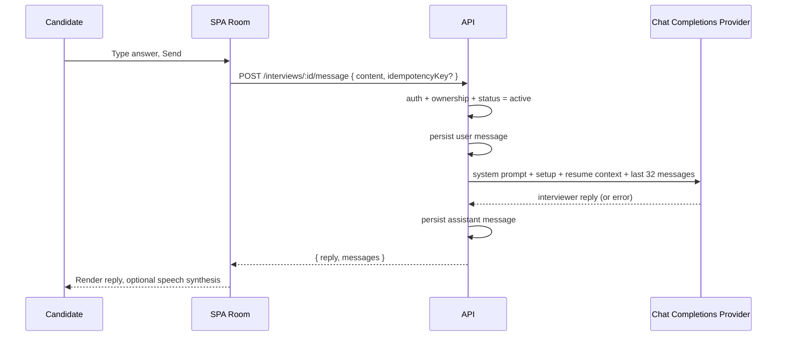
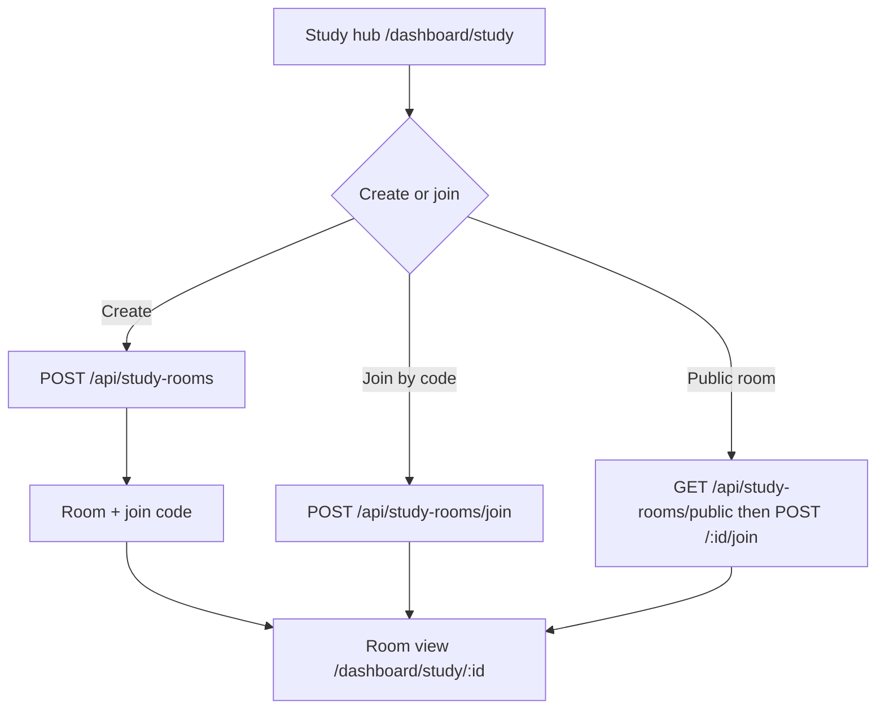
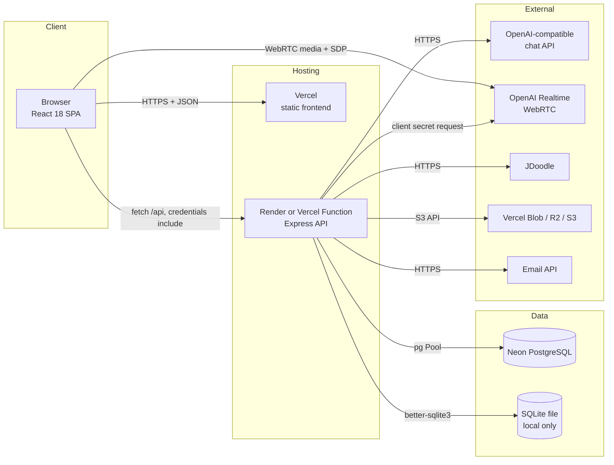
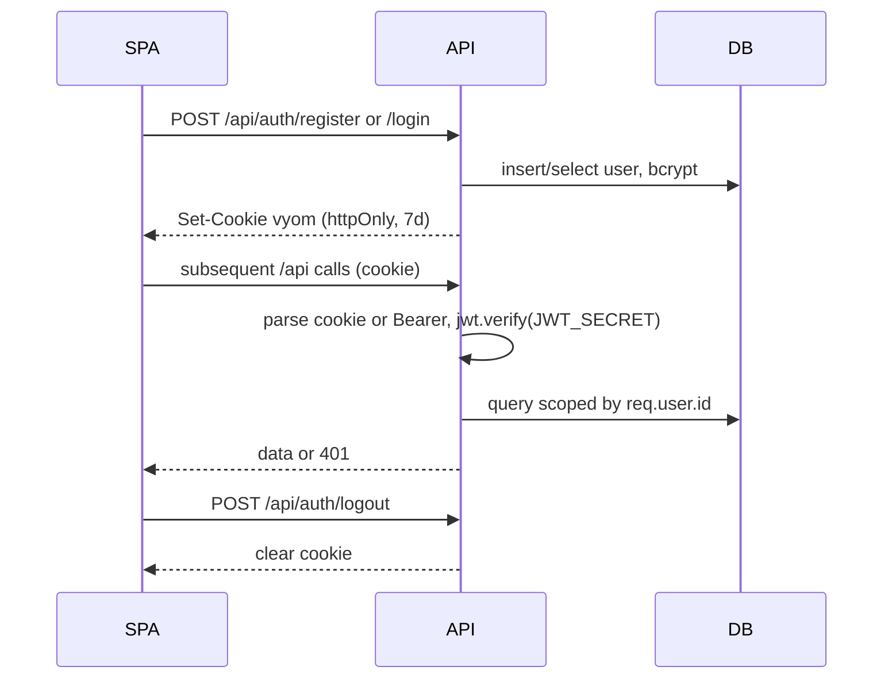
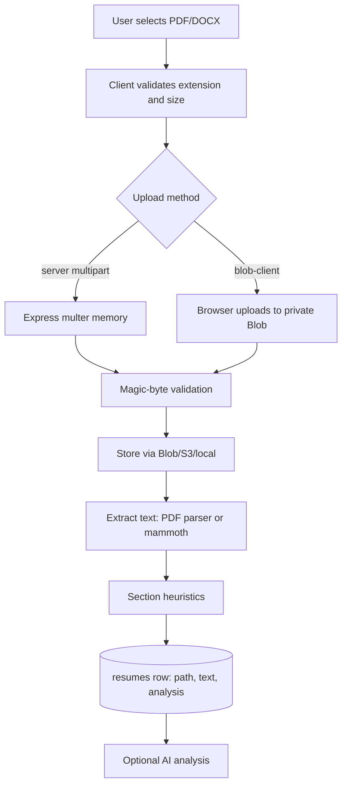
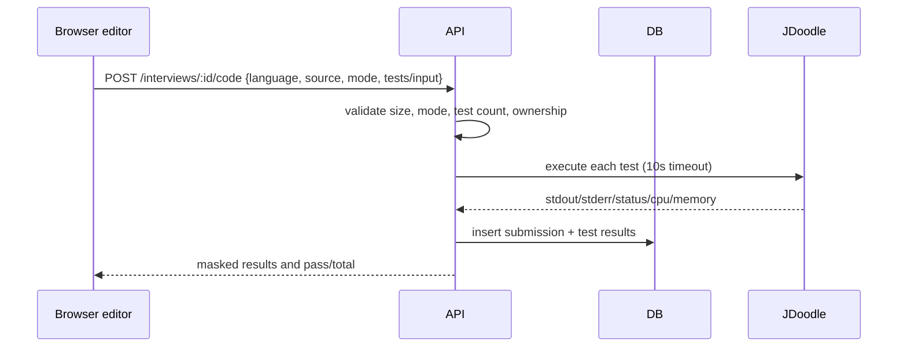
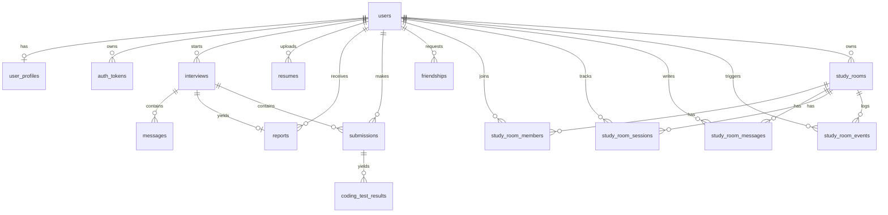

# VYOM AI — Complete Project Documentation

**Project name:** VYOM AI — *Face the Interview. Own the Future.*
**Document type:** Full technical and academic project documentation
**Codebase inspected:** `frontend/` and `backend/` (monorepo), configuration files, database layer, migrations, automated tests
**Documentation baseline:** commit `8f272c4` (`feat: add ResumePage and StudyPage components...`)
**Verification date:** 17 November 2026
**Documentation scope:** Documentation only. No application source, schema, deployment or external service was changed for this document.

| Verification item | Result at time of writing |
|---|---|
| Backend automated tests (`npm test` in `backend/`) | 28 tests, 28 passed, 0 failed |
| Frontend automated tests (`npm test` in `frontend/`) | 9 tests, 9 passed, 0 failed |
| Frontend production build (`npm run build`) | Succeeded — 47 modules, `index-*.js` 289.00 kB (87.17 kB gzip), `index-*.css` 92.71 kB (18.22 kB gzip) |
| Local database used for verification | SQLite (`backend/server/data/vyom.sqlite`) |
| Live OpenAI / JDoodle / email / Google credentials | **Not available** — those integrations were verified through code inspection, configuration guards and automated tests with stubbed providers, not live calls |

---

## Table of Contents

1. [Project Introduction](#1-project-introduction)
2. [Problem Statement and Proposed Solution](#2-problem-statement-and-proposed-solution)
3. [Complete Feature Documentation](#3-complete-feature-documentation)
   - [A. User Authentication](#a-user-authentication)
   - [B. Dashboard](#b-dashboard)
   - [C. AI Voice Interview](#c-ai-voice-interview)
   - [D. AI Interviewers](#d-ai-interviewers)
   - [E. Resume Management and Analysis](#e-resume-management-and-analysis)
   - [F. Coding Lab](#f-coding-lab)
   - [G. Leaderboard and Ranking](#g-leaderboard-and-ranking)
   - [H. Study Rooms](#h-study-rooms)
   - [I. Interview Reports and History](#i-interview-reports-and-history)
   - [J. Profile and Settings](#j-profile-and-settings)
4. [How Each Feature Helps Users](#4-how-each-feature-helps-users)
5. [Complete Technical Architecture](#5-complete-technical-architecture)
6. [Technology Stack](#6-technology-stack)
7. [Database Documentation](#7-database-documentation)
8. [API Documentation](#8-api-documentation)
9. [Project Folder Structure](#9-project-folder-structure)
10. [Installation and Local Setup](#10-installation-and-local-setup)
11. [Deployment Architecture](#11-deployment-architecture)
12. [Security and Privacy](#12-security-and-privacy)
13. [Current Implementation Status](#13-current-implementation-status)
14. [Future Scope and Development Roadmap](#14-future-scope-and-development-roadmap)
15. [Testing and Validation](#15-testing-and-validation)
16. [Academic Project Information](#16-academic-project-information)
17. [Documentation Quality, Verification Notes and Limitations](#17-documentation-quality-verification-notes-and-limitations)

[Appendix A — Environment Variable Reference](#appendix-a--environment-variable-reference)
[Appendix B — Status Label Definitions](#appendix-b--status-label-definitions)
[Appendix C — Glossary](#appendix-c--glossary)

---

## 1. Project Introduction

### 1.1 What VYOM AI is

VYOM AI is a full-stack web application for **interview practice, coding practice, resume preparation and collaborative study**. A signed-in user can:

- configure and run a mock interview against a named AI interviewer personality, in text or live voice mode;
- attach a private PDF/DOCX resume so interview questions can reference the user's background;
- solve curated data-structures-and-algorithms problems in four programming languages through a remote code-execution provider;
- receive an AI-generated report with category scores, strengths, improvements, per-question feedback and a suggested next difficulty;
- track interview history, analytics and a points-based leaderboard;
- create or join private/public **study rooms** with group chat, shared Pomodoro timing, individual focus tracking and a room-level contribution board;
- manage profile details, password and visual theme.

The product is implemented as a **monorepo** with a React single-page application (`frontend/`) and an Express REST API (`backend/`) that supports both **SQLite** (local development) and **PostgreSQL/Neon** (production) through a database adapter.

### 1.2 The problem it addresses

Interview preparation for students and early-career job seekers is usually fragmented:

- **Practice is expensive or unavailable.** Human mock interviews require a mentor, peer or paid coach, and scheduling is difficult.
- **Feedback is slow and inconsistent.** Learners often practise alone and have no structured, immediate assessment.
- **Coding practice is detached from interview practice.** Most platforms offer either DSA problems or mock interviews, not both with a shared progress record.
- **Resumes are treated as static files.** Users rarely receive structured feedback on whether their resume supports the roles they are targeting.
- **Study is solitary.** Peer accountability (co-working, shared timers) is rarely built into interview-prep tools.
- **Progress is invisible.** Without history, analytics and ranking, learners cannot see whether they are improving.

VYOM AI combines these activities in one authenticated workspace with an evidence-based AI feedback loop.

### 1.3 Why it was developed

The project was developed as a **complete, deployable interview-preparation platform** rather than a UI prototype. The codebase deliberately implements:

- real authentication with server-issued sessions, not hardcoded demo users;
- persistent interviews, messages, reports, submissions, resumes, friendships and study-room data;
- provider integrations behind capability checks so missing credentials produce honest **503** responses instead of simulated success;
- a dual-database layer so the same application code runs on a local SQLite file and Neon PostgreSQL;
- automated tests for the non-trivial logic (judging, scoring, timer aggregation, ownership, storage provider selection, provider failure handling).

### 1.4 Main objectives

1. Provide realistic, role-specific interview practice with adaptive AI follow-up questions.
2. Give immediate, structured and evidence-based feedback after every session.
3. Let candidates practise coding in an interview-like workspace with visible and hidden tests.
4. Use the candidate's own resume to personalise interview context.
5. Make progress measurable through reports, analytics, XP levels and leaderboards.
6. Support collaborative study with shared timers, presence and chat.
7. Keep private data isolated per user, with private resume storage and authenticated file access.
8. Remain deployable on a free-tier-friendly stack (Vercel + Render + Neon).
9. Degrade honestly: if an external provider is not configured, the feature reports that it is unavailable.

### 1.5 Target users

| User group | Primary need | VYOM AI features used |
|---|---|---|
| College students preparing for placements | Repeated low-cost mock interviews and coding practice | AI interviews, reports, Coding Lab, leaderboard |
| Final-year students / fresh graduates | Resume feedback and role-specific preparation | Resume library, resume-aware interviews, analytics |
| Job switchers | Practise specific roles, difficulty levels and interview languages | Interview setup, interviewer personalities, history |
| Peer study groups | Shared accountability and focus sessions | Study rooms, group chat, shared Pomodoro, group time |
| Self-learners | Visible progress and a practice routine | Dashboard stats, XP/levels/badges, recent activity |
| Project evaluators / faculty | Understand a complete software engineering project | This document, architecture, schema, tests, academic section |

### 1.6 Differentiation from traditional preparation platforms

| Traditional approach | VYOM AI behaviour |
|---|---|
| One generic question list | Role, experience level, difficulty, session type, language and interviewer personality shape the session |
| Feedback after days | Report generated immediately at the end of a session (when the AI provider is configured) |
| Interview practice separate from coding | Coding submissions are attached to an interview and included as evidence in the final report |
| Resume uploaded but never used | Extracted resume text and AI analysis are supplied as interview context |
| Fake demo profiles and scores | All dashboard, leaderboard and study data is computed from the authenticated user's persisted records; no seeded public users or fabricated activity |
| Silent failure when a provider is down | Missing or failing integrations return explicit errors (for example 503 with a configuration message) |
| Single-player only | Friends, friends leaderboard and study rooms with presence, timers, chat and shared Pomodoro |

### 1.7 Value to students and job seekers

- **Volume of practice:** unlimited sessions without scheduling a human interviewer.
- **Structure:** every session produces a transcript, a report (when AI is available) and a history entry.
- **Honesty:** the report prompt instructs the model to score only evidence and to use `null` for unobservable categories; coding evidence is passed separately and unexecuted code is not treated as passing.
- **Breadth:** interview, coding, resume and group study in one account.
- **Portability:** runs locally with zero external credentials (SQLite + local storage), and can be upgraded to a production stack through environment variables.

### 1.8 Project overview and executive summary

VYOM AI is a two-tier web system. The React SPA handles routing (manual path dispatch in `App.jsx`), authentication state, the interview room, voice session, code editor, leaderboards, study rooms and account pages. The Express API owns authentication, authorization, persistence, AI calls, resume parsing/storage and code execution. A database adapter chooses PostgreSQL when `DATABASE_URL` is present and SQLite otherwise. Migrations are applied automatically for SQLite at startup; PostgreSQL migrations are applied only through explicit CLI scripts. Resume files are stored through a provider abstraction (Vercel Blob, S3-compatible storage such as Cloudflare R2, or local disk in development) and are never served from a public URL. Every AI, code-execution, email, Google and object-storage integration is guarded by capability checks and exposed to the client only as booleans via `GET /api/config`.

At the documentation baseline, authentication, dashboard, interviews in text mode, reports logic, resume upload/parsing/library operations, leaderboard, study rooms and the responsive workspace were exercised locally. Live voice, live AI analysis/report generation, live JDoodle execution, live email and Google sign-in require credentials that were not available and are therefore marked accordingly in [Section 13](#13-current-implementation-status).

---

## 2. Problem Statement and Proposed Solution

### 2.1 Problems faced by students and job seekers

| # | Problem | Practical consequence |
|---|---|---|
| P1 | No affordable, repeatable mock interview | Candidates enter real interviews without spoken practice |
| P2 | No personalised practice | Generic question lists ignore the candidate's role, experience, resume and weak areas |
| P3 | Delayed or vague feedback | Learners cannot tell what to fix before the next attempt |
| P4 | Coding practice lacks interview context | Users solve problems but cannot explain complexity or connect code to interview evaluation |
| P5 | Resume uncertainty | Candidates do not know whether their resume evidences the skills for their target role |
| P6 | No structured learning path | Practice is ad hoc; there is no history, trend or next-step recommendation |
| P7 | Solitary preparation | No accountability, peer comparison or co-working |
| P8 | Fragmented tools | Separate sites for interviews, coding, resumes and study; no shared progress record |

### 2.2 How VYOM AI addresses each problem

| Problem | Implemented response | Evidence in code |
|---|---|---|
| P1 | Text and live-voice mock interviews with a timer, transcript, mute/pause, end-and-report flow | `frontend/src/App.jsx` (`Room`), `frontend/src/VoiceSession.jsx`, `POST /api/interviews/:id/message`, `POST /api/interviews/:id/voice/session` |
| P2 | Setup captures role, type, difficulty, interviewer, duration, company, topics, experience level, interview language and optional resume | `POST /api/interviews`, interview context builder in `backend/server/ai-coding-routes.js` |
| P3 | Structured report with 10 category scores, strengths, improvements, summary, per-question feedback, suggested answers, next difficulty and study block | `POST /api/interviews/:id/finish`, `frontend/src/App.jsx` (`ReportPage`) |
| P4 | 5 curated problems, 4 languages, run/submit modes, visible + hidden tests, CPU/memory output, submission history; coding evidence is included in report generation | `backend/server/coding-problems.js`, `backend/server/jdoodle.js`, `backend/server/ai-coding-routes.js`, `frontend/src/CodingRoom.jsx` |
| P5 | PDF/DOCX validation, text extraction, section heuristics, AI analysis (when configured), preview/download/delete, resume-aware interviews | `backend/server/resume-routes.js`, `pdf.js`, `resume-analysis.js`, `frontend/src/ResumePage.jsx` |
| P6 | Dashboard stats, 20-per-page history with filters, analytics category averages, XP levels, badges, weekly/lifetime leaderboards | `GET /api/dashboard`, `GET /api/interviews`, `GET /api/analytics`, `GET /api/leaderboard` |
| P7 | Friends, friends leaderboard, private/public study rooms, group chat, presence, shared Pomodoro, group focus time | `backend/server/community-routes.js`, `frontend/src/StudyPage.jsx`, `LeaderboardPage.jsx` |
| P8 | One account and one database for all activity; reports reference interviews; submissions reference interviews; study time contributes to leaderboard points | Database schema in `backend/server/migrate.js` |

### 2.3 What the system deliberately does **not** do

- It does not simulate an AI response when no AI provider is configured.
- It does not mark code as passing without an execution result.
- It does not display fake online users, fake scores or seeded public profiles.
- It does not expose resume files on a public URL.
- It does not claim email delivery when the mail provider is not configured (registration auto-verifies in that case, and the UI/API indicate verification is not required).

These constraints are implemented as behaviours, not just documentation claims.

---

## 3. Complete Feature Documentation

### A. User Authentication

#### A.1 Registration

- **Route:** `/signup` in the SPA (`Auth` component, `mode="signup"`).
- **Endpoint:** `POST /api/auth/register`.
- **Validation:** name required (trimmed), email must match a simple email regex, password must be a string of at least **10 characters**.
- **Password storage:** `bcryptjs` hash with cost **12**; plaintext passwords are never stored.
- **Duplicate email:** unique constraint violation (`SQLITE_CONSTRAINT_UNIQUE` or PostgreSQL `23505`) returns **409** with a friendly message.
- **Two registration modes:**
  - **Mail configured** (`MAIL_API_KEY` and `MAIL_FROM`): a single-use verification token is created, hashed with SHA-256, stored in `auth_tokens` with a 30-minute expiry, and emailed as a link to `{APP_ORIGIN or CLIENT_ORIGIN or http://localhost:5173}/verify?token=...`. The response is `201 { user, requiresVerification: true, mailSent: true }`; if sending fails, `mailSent: false` and the account still exists.
  - **Mail not configured:** the user is created with `email_verified = true`, a session cookie is issued immediately, and the response is `201 { user, requiresVerification: false }`.
- **Frontend behaviour:** after registration, the Auth page either signs the user in or shows the verification notice depending on the response.

#### A.2 Sign-in

- **Route:** `/login`.
- **Endpoint:** `POST /api/auth/login`.
- **Lookup:** email is lowercased before the query.
- **Credential check:** `bcrypt.compare`; failure returns **401** `Email or password is incorrect.` (no distinction between unknown email and wrong password).
- **Verification gate:** only enforced when mail is configured (`MAIL_API_KEY` and `MAIL_FROM` present) and `email_verified` is false → **403** `Verify your email before signing in.`
- **Session issuance:** JWT signed with `JWT_SECRET`, payload `{ id, email }`, expiry **7 days**, delivered as an **httpOnly** cookie named `vyom` and also accepted later as `Authorization: Bearer <token>`.

#### A.3 Session and authentication flow

```mermaid
sequenceDiagram
  participant B as Browser (React SPA)
  participant A as Express API
  participant D as Database
  B->>A: POST /api/auth/login {email, password}
  A->>D: SELECT user by email
  D-->>A: user row (bcrypt hash)
  A->>A: bcrypt.compare + verification gate
  A-->>B: Set-Cookie vyom=JWT; HttpOnly; SameSite; 7 days
  B->>A: GET /api/auth/me (cookie sent automatically)
  A->>A: jwt.verify, attach req.user
  A-->>B: { user }
  Note over B,A: Every protected request repeats cookie verification.
  B->>A: POST /api/auth/logout
  A-->>B: Clear-Cookie vyom
```

- The API reads the token from the parsed cookie first, then from `Authorization` as a Bearer token.
- `cookieOpts` (`backend/server/index.js`): `httpOnly: true`, `sameSite` from `COOKIE_SAME_SITE` (default `lax`), `secure` when `NODE_ENV=production` or SameSite is `none`, `maxAge: 7 days`.
- Logout clears the cookie; there is **no server-side token denylist**, so an already-issued JWT remains cryptographically valid until expiry if it was copied elsewhere. This is a documented limitation.
- On app load, the SPA calls `GET /api/auth/me`; `{ user: null }` means signed out. The frontend stores the user in React state only.

#### A.4 Email verification

- **Link target:** `/verify?token=...`, rendered by `VerifyEmail` (`frontend/src/AccountPages.jsx`).
- **Endpoint:** `GET /api/auth/verify?token=...`.
- **Mechanism:** only a SHA-256 hash of the token is stored; lookup requires `kind='verify_email'`, `used_at IS NULL`, and a database-specific expiry comparison. On success the user is marked verified and the token is marked used.
- **Resend:** `POST /api/auth/verification/resend` accepts an email, invalidates nothing by itself, and issues a new token when the account exists and is unverified. The route intentionally returns a generic message to avoid account enumeration.
- **Frontend route for resend:** `/resend-verification`.

#### A.5 Password reset

- **Request:** `POST /api/auth/forgot-password { email }`. A reset token (`kind='reset_password'`, 30 minutes, hashed) is emailed if the account exists. The response is generic.
- **Completion:** `POST /api/auth/reset-password { token, password }`, minimum **10 characters**, bcrypt cost 12. On success, both reset and verification tokens for the user are marked used.
- **Frontend routes:** `/forgot-password` and `/reset-password` (token read from the query string by `ResetPassword`).
- **Change password while signed in:** `POST /api/auth/change-password` (requires auth) verifies the current password and hashes the new one; the Settings page uses it.

#### A.6 Google sign-in

- **Endpoint:** `POST /api/auth/google { credential }` — the SPA sends a Google ID token.
- **Configuration guard:** if `GOOGLE_CLIENT_ID` is absent, the API returns **503** `Google sign-in is not configured.`
- **Verification:** the server calls Google's token-info endpoint, checks `aud` equals `GOOGLE_CLIENT_ID`, `email_verified === 'true'`, and `sub` presence.
- **Account linking:** matches by `google_sub` or lowercased email; creates a user with a random 40-byte password hash when new; otherwise links `google_sub` and marks the email verified.
- **Session:** same 7-day JWT cookie as password login.
- **Frontend:** the Auth page renders Google sign-in only if `VITE_GOOGLE_CLIENT_ID` is present; the backend independently enforces its own configuration.

#### A.7 Account-level behaviour

- Profile editing is separate (`GET/PUT /api/profile`).
- There is **no account deletion endpoint** and no self-service data export (other than downloading a report as JSON).
- The user's display name and email come from the `users` table; `profile_image` exists in the schema but no upload flow is implemented.
- `DEMO_ACCOUNTS` only exposes a boolean in `/api/config`; no demo seeding code exists.

---

### B. Dashboard

#### B.1 Layout and navigation

- **Route:** `/dashboard` (`Dashboard` component inside `DashboardShell`).
- **Workspace shell:** `frontend/src/DashboardShell.jsx` provides a responsive sidebar with three groups:
  - **Workspace:** Overview (`/dashboard`), New interview (`/interview/setup`), Interview history (`/dashboard/interviews`), Analytics (`/dashboard/analytics`)
  - **Grow:** Resume library (`/dashboard/resume`), Code Lab (`/dashboard/coding`), Leaderboard (`/dashboard/leaderboard`), Study rooms (`/dashboard/study`)
  - **Account:** Profile (`/dashboard/profile`), Settings (`/dashboard/settings`)
- On screens narrower than the desktop breakpoint, the sidebar becomes a drawer; it closes on route change and supports keyboard escape. Marketing navigation is hidden inside `/dashboard*`; the workspace shell owns navigation there.
- Account pages are wrapped by `App.jsx`; the Resume, Leaderboard and Study components wrap themselves in `DashboardShell`. `/dashboard/coding` (`CodingHome`) is a short full-screen page that creates or reuses a workspace and immediately navigates to `/interview/:id/coding`, which is a dedicated full-screen coding lab without the sidebar.

#### B.2 Data source and meaning of statistics

`GET /api/dashboard` returns:

```json
{
  "interviews": [
    { "id": "...", "role": "...", "type": "...", "difficulty": "...", "status": "active|completed", "created_at": "..." }
  ],
  "stats": {
    "completed": 0,
    "averageScore": null,
    "hours": 0,
    "friends": 0,
    "studyHours": 0
  }
}
```

| Statistic | Exact computation |
|---|---|
| `completed` | Number of rows in `reports` for the user (equivalently, number of scored sessions) |
| `averageScore` | Rounded average of `reports.overall_score`; `null` when there are no reports |
| `hours` | Sum of `interviews.duration` for completed interviews, divided by 60, rounded to one decimal. `duration` is the **configured session length in minutes**, not measured elapsed time |
| `friends` | Count of accepted friendships where the user is requester or addressee |
| `studyHours` | Individual tracked study seconds ÷ 360, rounded to one decimal (i.e. one-decimal hours via `Math.round(seconds/360)/10`) |
| `interviews` | The 8 most recent interviews, ordered by `created_at` descending |

#### B.3 Dashboard panels

- **Welcome/hero area** with the signed-in user's name, primary call to action to start a new interview, and quick links.
- **Stats cards** for completed interviews, average score, practice hours, friends and study hours. The ranking/stat link navigates to `/dashboard/leaderboard`.
- **Coding & ranking panel:** fetches `GET /api/coding/progress` (solved/total, submitted runs, verified tests) and `GET /api/leaderboard?scope=global&period=all` (global rank, points, completed interviews, average score), with links to the Code Lab and leaderboard.
- **Study rooms panel:** summarises up to four rooms the user belongs to via `GET /api/study-rooms`, including member count and invite code.
- **Recent activity:** the last interviews with status, role and score, linking to the room or report.
- **Recommended actions:** start a new interview, upload a resume, open the Coding Lab, or join a study room.

#### B.4 Freshness and failure behaviour

- Data is loaded when the page mounts (no background polling on the dashboard).
- If the API returns an error, the affected panel shows an error/empty state rather than invented data.
- A signed-out visitor who opens `/dashboard` is shown the page shell but panels fail their authenticated calls; the app does not fabricate a user. (The app's normal flow redirects unauthenticated users via the navigation/auth affordances; the API itself always enforces auth.)

---

### C. AI Voice Interview

#### C.1 Configuration (Setup page)

**Route:** `/interview/setup` (`Setup` in `App.jsx`).

The user chooses:

| Field | Options / meaning |
|---|---|
| Role | Free-form target role (for example "Frontend Developer") |
| Interview type | Technical, Behavioural, System Design, DSA / Coding, HR / Culture Fit, Mixed |
| Difficulty | Easy, Medium, Hard |
| Interviewer | One of six personalities (see Section D) |
| Duration | Session length in minutes; the server clamps it to **10–60** (default 20) and stores it on the interview |
| Company (optional) | Target company for tailored context |
| Topics (optional) | Comma-separated focus areas |
| Experience level | Stored in `interviews.experience_level` |
| Interview language | Stored in `interviews.interview_language`, default `English`; used in prompts and voice instructions |
| Resume (optional) | Selected from the user's resume library; the backend verifies ownership before attaching |

`POST /api/interviews` validates the payload (role, type, difficulty, duration bounded by server rules), checks resume ownership, inserts the row and returns `201 { interview }`.

#### C.2 Interview room

**Route:** `/interview/:id` (`Room` component).

- Loads `GET /api/interviews/:id` → `{ interview, messages }`.
- If the interview is active, the SPA calls `POST /api/interviews/:id/start`; if no messages exist, the backend generates and persists an opening interviewer question. The opening message has a deterministic id (`opening-<interviewId>`) and the insert is conflict-safe, so the concurrent-start test passes without duplicated openings.
- **Text mode:** the candidate types an answer, submits it, and receives the AI interviewer's next reply. Suggested/adaptive follow-ups come from the model; the system prompt includes the interview configuration and recent transcript.
- **Timer:** the room displays a countdown based on the configured duration and tracks elapsed time; ending is explicit via "End & report".
- **Read-aloud:** browser `speechSynthesis` can read interviewer messages aloud.
- **Speech-to-text (optional in text mode):** the Web Speech API (`SpeechRecognition` / `webkitSpeechRecognition`) can dictate the answer into the textarea when supported. If unsupported, a clear fallback message is shown and typing still works.
- **Voice mode:** see C.4.

#### C.3 Message flow (text)



Implementation details:

- The route is guarded by `auth` and the `owned` middleware (interview must belong to the authenticated user).
- If `OPENAI_API_KEY` is not configured, `completion()` throws a **503** configuration error and the UI displays it. No canned reply is generated.
- The **user message is saved before the AI call**, so a failed AI turn does not lose the candidate's answer. The assistant message is saved only after a successful reply.
- `Idempotency-Key` (request header) is supported: repeated submissions with the same key return the existing user message and avoid duplicate persistence. The SPA's transcript helper uses this for voice.
- Only the most recent **32** messages are sent to the model to bound token usage.
- Session state: interviews are `active` until a report is successfully generated; a completed interview returns **409** for new messages.

#### C.4 Live voice mode

- **Client:** `frontend/src/VoiceSession.jsx`.
- **Prerequisites:** secure context (HTTPS or localhost), microphone permission, and backend `OPENAI_API_KEY`.
- **Session creation:** `POST /api/interviews/:id/voice/session` requests an ephemeral client secret from the OpenAI-compatible Realtime endpoint `/realtime/client_secrets` with:
  - `expires_after.seconds = 600`
  - session model `OPENAI_REALTIME_MODEL` (default `gpt-realtime-2.1`)
  - input transcription model `OPENAI_TRANSCRIBE_MODEL` (default `gpt-transcribe`)
  - server VAD with response creation and interruption enabled
  - output voice `OPENAI_REALTIME_VOICE` (default `marin`)
  - interview instructions (personality, configuration, resume context, recent transcript) and the interview language
  - an `OpenAI-Safety-Identifier` header derived as a SHA-256 hash of the user id
- The API returns `{ client_secret, model, call_url }`; `call_url` defaults to `https://api.openai.com/v1/realtime/calls` and is overridable with `OPENAI_REALTIME_URL`.
- **WebRTC:** the browser captures the microphone with `getUserMedia`, creates an `RTCPeerConnection`, adds the audio track, opens the `oai-events` data channel, posts an SDP offer to `call_url` with the ephemeral secret, and applies the SDP answer.
- **Event handling:** `oai-events` messages (session created, speech started/stopped, transcript deltas/completions, errors) drive UI state: listening, speaking, muted, paused.
- **Persistence:** finalized user and assistant transcripts are queued sequentially and sent to `POST /api/interviews/:id/transcript` so the saved text matches what was spoken. Idempotency keys prevent duplicates. The UI does not fabricate interviewer audio.
- **Controls:** mute/unmute, pause/resume, stop/end. Ending voice mode returns to the room where the user can finish and generate the report.
- **Failure handling:** missing key → 503 with "Realtime voice needs OPENAI_API_KEY configured on the server."; provider non-OK → 502; microphone denial or unsupported browser → visible error, text mode remains available.
- **Verification status:** the UI and API guards were exercised locally; a live WebRTC session was **not** run because no OpenAI key was available.

#### C.5 Completion and report

- "End & report" calls `POST /api/interviews/:id/finish`.
- Requirements: interview is active, owned by the user, and has at least one **user** message; otherwise 400/409 with a specific message.
- A 5-minute claim (`finish_started_at`) prevents duplicate concurrent report generation. If the AI call fails, the claim is cleared so the user can retry.
- On success the report row is written (upsert by `interview_id`), the interview is marked `completed`, and the parsed report is returned.
- The SPA redirects to `/interview/:id/report`.
- Interview history (`/dashboard/interviews`) lists sessions with status and score; completed sessions link to the persisted report.

#### C.6 What is real vs. what depends on credentials

| Capability | Status |
|---|---|
| Setup, persistence, ownership, timer, text room UI, transcript storage, history | Implemented and locally verified |
| AI opening question and replies | Implemented; requires `OPENAI_API_KEY` |
| Browser dictation in text mode | Implemented with feature detection; availability depends on browser |
| Read-aloud | Implemented with `speechSynthesis`; voice availability depends on OS/browser |
| Live voice WebRTC | Implemented; requires OpenAI Realtime access and a live test |
| Report generation | Implemented; requires `OPENAI_API_KEY` |

---

### D. AI Interviewers

Six interviewer profiles are defined in the frontend and mapped to prompt personalities on the backend:

| Interviewer | Displayed style / specialisation | Selection |
|---|---|---|
| **Arjun — Friendly Guide** | Warm, encouraging, structured; good for first sessions | Chosen in Setup; stored in `interviews.interviewer` |
| **Tanya — Supportive Coach** | Constructive, reflective, focuses on communication and confidence | Same |
| **Samarth — Technical Pro** | Precise technical questioning, fundamentals and trade-offs | Same |
| **Riddhi — Deep Diver** | Probes reasoning, follow-up "why" questions, depth over breadth | Same |
| **Vivan — Staff Engineer** | Senior-level architecture, system design and engineering judgement | Same |
| **Shreya — Edge-case Expert** | Tests boundaries, failure modes, correctness and complexity | Same |

How selection and interaction work:

1. Setup sends the interviewer name as part of `POST /api/interviews`.
2. `assistantSystem()` in `backend/server/ai-coding-routes.js` builds a system prompt that combines the interviewer personality, role, type, difficulty, company, topics, experience level and language with recent transcript context.
3. The same prompt (plus resume context when attached) is used for text replies and as the basis for realtime voice instructions.
4. The interviewer name is persisted and shown in the room/history; it is not only a visual label.

The personalities change tone and questioning emphasis; they are not separate AI models.

---

### E. Resume Management and Analysis

#### E.1 Supported formats and limits

| Item | Value |
|---|---|
| Accepted extensions | `.pdf`, `.docx` |
| Accepted MIME types | `application/pdf`, `application/vnd.openxmlformats-officedocument.wordprocessingml.document` |
| Maximum size | **8 MB** (`MAX_RESUME_BYTES`) |
| Upload path on Vercel | Direct browser-to-Blob upload (`blob-client`) with a server-issued token, 8 MB |
| Multipart fallback limit on Vercel | **4 MB**, because the serverless request body limit is lower than 8 MB |
| Blob client-upload endpoint limit | 8 MB |
| Validation | Extension + MIME + **magic bytes**: `%PDF-` for PDF; ZIP signature plus `[Content_Types].xml` entry for DOCX |

The frontend obtains the limit and upload method from `GET /api/resumes/upload-config` and validates extension and size before uploading. When the config reports `method: "blob-client"` (Vercel with `BLOB_READ_WRITE_TOKEN`), the Resume page uploads the file directly from the browser to private Blob storage and then confirms it with the server, so the 8 MB limit does not pass through the 4.5 MB function body cap. Everywhere else the page uses the multipart server path.

#### E.2 Upload and storage

- **Blob client-upload path** (`POST /api/resumes/blob-upload`, used by the Resume page when `method` is `blob-client`) is the primary production path. The server authenticates the user, validates the requested `resumes/<userId>/<uuid>.<pdf|docx>` pathname, rejects duplicate IDs, and issues a Blob client token restricted to the two resume MIME types, an 8 MB maximum and no random suffix. After the browser uploads, the upload-completed callback and the client's `POST /api/resumes/:id/confirm` call the same finalize routine: read the object back privately, enforce ≤ 8 MB and magic bytes, then create the owner-scoped row. The routine is idempotent, and a failed finalize deletes the blob when no row exists so failed database writes cannot leave orphans.
- **Server path** (`POST /api/resumes`, multipart field `resume`, `multer` memory storage) remains for local development and as a fallback where `method` is `server`. On Vercel with Blob configured it is limited to the 4 MB function body size.
- **Storage provider priority** (`storageProvider()`):
  1. `blob` — when `BLOB_READ_WRITE_TOKEN` is set (Vercel Blob, private access);
  2. `s3` — when `S3_BUCKET`, `S3_ACCESS_KEY_ID` and `S3_SECRET_ACCESS_KEY` are set (hand-rolled AWS Signature V4; works with Cloudflare R2 and S3-compatible endpoints);
  3. `local` — development only, writes to `UPLOAD_DIR` (default `./server/uploads` when the backend is the working directory);
  4. `none` — production/Vercel without Blob or S3; uploads return **503** rather than writing to ephemeral disk.
- **Downloads** for `blob:` references are owner-checked, then redirect (302, `Cache-Control: private, no-store`) to a short-lived (5 minute) presigned private URL; `?download=1` adds a download disposition. No public Blob URL is exposed.
- **Deletion** removes the Blob object first and then the owner-scoped database row; if object deletion fails the row is kept and the request returns 502 so storage and database stay consistent.
- The database stores an opaque reference in `resumes.path`:
  - `blob:<pathname>` for Blob,
  - `s3:<key>` for object storage,
  - an absolute/relative local path in development.
- Filenames are sanitized; storage keys use the authenticated user id and a server-generated UUID, so client filenames cannot traverse directories.

#### E.3 Parsing

| Format | Method |
|---|---|
| PDF | Custom extractor in `backend/server/pdf.js`: parses PDF objects/streams, inflates `FlateDecode` streams with `zlib`, interprets literal strings and `Tj`/`TJ`/`'`/`"` text operators, reconstructs lines. Scanned/image-only PDFs yield no text. |
| OCR fallback (optional) | When `PDFTOPPM_CMD` and `TESSERACT_CMD` are configured, the server renders pages with `pdftoppm` and runs Tesseract, honoring `TESSERACT_LANG`. Not exercised in the verified environment because the binaries were absent. |
| DOCX | `mammoth` extracts raw text. |
| Sections | Heuristic regexes return an object with `email`, `phone`, `education`, `skills`, `experience`, `projects` and `certifications`. Each section is a plain text **string** (not an array); missing sections are empty strings. The email/phone values are extracted from the text, not inferred. |

Parsing failures do not leave orphaned blobs: the stored object is deleted if the DB write fails.

#### E.4 AI analysis

- `backend/server/resume-analysis.js` sends extracted text to the configured OpenAI-compatible chat model with a JSON-schema-style instruction and an evidence-based prompt.
- Without `OPENAI_API_KEY`, upload still succeeds; the response includes `analysis_status: "unavailable"` and a message explaining that analysis requires the key. The Analyze button then returns **503**.
- If analysis fails after parsing, the resume remains saved, `analysis_status` is `"failed"`, and the user can retry with `POST /api/resumes/:id/analyze`.
- Analysis output is stored as JSON in `resumes.analysis`; the library parses it and exposes `ai_analyzed` plus the object.
- The analysis prompt sends up to **18,000 characters** of extracted text and requires evidence-only output. The server normalizes the result to `summary` (required, ≤ 1,200 characters) plus arrays `education`, `skills`, `experience`, `projects`, `strengths` and `follow_up_questions` (each trimmed, non-empty, max 20 items). A missing summary or unparseable JSON is treated as a provider failure (502). There are no separate "gaps" or "role fit" fields.

#### E.5 Resume-aware interview preparation

- Setup accepts a `resume_id`; `POST /api/interviews` verifies the resume belongs to the user before storing the reference.
- `interviewContext()` loads profile fields, up to **7,000 characters** of extracted resume text, and the stored analysis, then includes them in the interviewer system prompt. Resume content is therefore optional evidence, not a requirement.

#### E.6 Library operations

- **List:** `GET /api/resumes` returns newest first with `analyzed`, `sections`, `analysis`, `ai_analyzed`, MIME type and size.
- **Preview:** `GET /api/resumes/:id/file` streams the private object with `Content-Type`, `X-Content-Type-Options: nosniff`, `Cache-Control: private, no-store`, and inline disposition for PDF / attachment for DOCX. Ownership is checked on every request.
- **Download:** the SPA fetches the same endpoint as a blob and triggers a download.
- **Delete:** `DELETE /api/resumes/:id` deletes the stored object and the row. Deleting a resume does not delete interviews that referenced it (the reference remains historical).
- **Use in interview:** a link navigates to Setup with the resume preselected via router state.

#### E.7 What is actually supported

| Operation | Supported? |
|---|---|
| PDF (text-based) upload + extraction | Yes |
| Scanned PDF OCR | Only with external binaries configured; not enabled by default |
| DOCX upload + extraction | Yes |
| AI analysis | Only with an AI key |
| Private preview/download | Yes (authenticated) |
| Delete | Yes |
| Public sharing links | No (by design) |
| Resume editing inside the app | No |
| Multiple files per interview | No — one optional resume per interview |

---

### F. Coding Lab

#### F.1 Problem catalogue

Defined in `backend/server/coding-problems.js`:

| Key | Title | Difficulty | Topics | Tests |
|---|---|---|---|---|
| `two-sum` | Two Sum | Easy | Arrays, Hash map | 4 (1 hidden) |
| `reverse-words` | Reverse Words | Easy | Strings, Two pointers | 4 (1 hidden) |
| `valid-parentheses` | Valid Parentheses | Medium | Strings, Stack | 4 (1 hidden) |
| `longest-substring` | Longest Unique Substring | Medium | Strings, Sliding window | 4 (1 hidden) |
| `merge-intervals` | Merge Intervals | Hard | Sorting, Intervals | 4 (1 hidden) |

Each problem includes a description, starter code for Python, JavaScript, Java and C++, a function-style submission contract, visible examples and hidden tests.

#### F.2 Entry points

- **Code Lab entry:** `/dashboard/coding` (`CodingHome`). It immediately calls `POST /api/coding/workspace`; the backend returns an active DSA interview (reusing an existing active coding-practice workspace when one exists, otherwise creating one) and the SPA navigates to `/interview/:id/coding`. This entry page is a short loading screen, not the problem catalogue.
- **Workspace:** `/interview/:id/coding` (`CodingWorkspace`) contains the problem list, difficulty filters, solved markers, progress card, editor and results. It can be opened for an existing owned interview; coding submissions attach to that interview and are later included as evidence in the report.
- **Problem filters and solved markers** are part of the workspace sidebar; the progress card shows solved problems, submission count and passed/total tests.

#### F.3 Editor and workspace UI

- A **textarea with a synchronized syntax-highlight overlay** (custom tokenizer in `CodingRoom.jsx`). There is no Monaco/CodeMirror dependency.
- Tab inserts indentation; `Ctrl+Enter` runs; language switch preserves a per-problem, per-language draft in memory/local state; reset restores the starter.
- Language selector: Python, JavaScript, Java, C++.
- Panels: problem statement, examples, constraints, output/test results, custom stdin, submission history, CPU/memory usage.
- Run vs Submit:
  - **Run** sends the custom input with one test (expected value `null`), so correctness is not asserted; it is for experimentation.
  - **Submit** runs the problem's tests (up to 4), masks hidden-test `input` and `expected_output` in the response, and reports pass/total. The program's own `actual` output is still returned for hidden tests (it is the candidate's output, not the hidden expected value).

#### F.4 Execution integration

- `backend/server/jdoodle.js` posts `{ clientId, clientSecret, script, language, versionIndex, stdin }` to `JDOODLE_API_URL` (default JDoodle endpoint) with a **10-second** timeout.
- Language names map to JDoodle language identifiers; version indexes come from `JDOODLE_PYTHON_VERSION_INDEX`, `JDOODLE_JAVASCRIPT_VERSION_INDEX`, `JDOODLE_JAVA_VERSION_INDEX`, `JDOODLE_CPP_VERSION_INDEX` (with defaults in code).
- Without both `JDOODLE_CLIENT_ID` and `JDOODLE_CLIENT_SECRET`, the API returns **503** with a configuration message. No local sandbox/executor exists.
- Source code is limited to **30,000 characters**; test input and `expected_output` to **5,000 characters** each; at most **4** `test_cases` per request. A run without `test_cases` falls back to the top-level `input` string; a submit always uses the selected problem's tests and cannot supply its own expected outputs.
- Test case objects use `{ input, expected_output, hidden }`. The client sends hidden flags only for catalogue tests it received; hidden test content itself is not published by `GET /api/coding/problems`.
- Comparison normalizes trailing whitespace/line endings for practical equality; results include status, time and memory when the provider returns them.

#### F.5 Submission persistence and progress

- Every run/submit is saved in `submissions` with `language`, `source`, JSON `result`, `problem_key`, `mode`, interview, user and timestamp.
- Per-test rows are stored in `coding_test_results` for executions that produce a boolean pass result (submission mode).
- `GET /api/coding/progress` returns:
  - `stats` — `submissions`, `solved`, `total_problems`, `passed_tests`, `total_tests`;
  - `solved_problems` — distinct problem keys with at least one fully passing **submit**;
  - `history` — the 20 most recent submissions with interview id, problem key/title, mode, language, passed/total for submits, and timestamp.
  It does not compute an "attempted" count or a per-difficulty breakdown.
- `GET /api/coding/problems` returns the catalogue with key, title, difficulty, topics, summary, description, constraints, examples, starters, `test_count` and `sample_tests` (only non-hidden tests; hidden test content is not included).
- Hidden test inputs and expected outputs are never returned to the client; submit responses include only the hidden flag, pass/fail, timing/memory and the candidate's own actual output.

#### F.6 Limits and honest gaps

| Item | Status |
|---|---|
| Real execution | Requires JDoodle credentials |
| Local execution sandbox | Not implemented |
| Additional languages | Not implemented |
| Problem authoring/admin UI | Not implemented (catalogue is code-defined) |
| Plagiarism/anti-cheat | Not implemented |
| Per-test persistence for runs | Only test rows with boolean results are stored |
| Elapsed time measurement in editor | UI timer exists in the interview room, not a separate coding stopwatch |

---

### G. Leaderboard and Ranking

#### G.1 Points model

`leaderboardPoints()` in `backend/server/community-routes.js`:

```
points = completed_interviews × 50
       + average_report_score           (0 when no reports)
       + coding_passed_tests × 5
       + coding_solved_problems × 15
       + floor(study_seconds / 60) × 2
```

Interpretation:

- `completed_interviews` counts persisted reports (scored sessions).
- `average_report_score` is the rounded average of `reports.overall_score` for the selected period.
- `coding_passed_tests` counts `coding_test_results.passed = true`.
- `coding_solved_problems` counts distinct problems with a fully passing **submit**.
- Study time uses tracked individual study seconds in the selected period.

Lifetime **XP** uses the same formula over lifetime activity. `weekly_points` uses the last **7 days**.

#### G.2 Periods and scopes

| Parameter | Values | Behaviour |
|---|---|---|
| `scope` | `friends` (default), `global` | `friends` = the user plus accepted friends. The leaderboard page and dashboard explicitly request `global`; omitting the parameter yields `friends` |
| `period` | `all` (default), `weekly` | `weekly` filters reports, submissions/test rows and study sessions to the last 7 days |

Sorting: period points descending, then completed interviews descending, then average score descending, then name ascending.

Response includes:

- top **100** ranked rows;
- the current user's row (`me`) even when outside the top 100;
- `me.next_rank`, `me.next_name`, `me.points_to_next` when someone is directly above;
- `badge_catalog` (definitions only);
- `updated_at`.

Each row contains: `rank`, `id`, `name`, `profile_image`, `points`, `xp`, `weekly_points`, level fields (`level`, `level_name`, `level_xp`, `next_level_xp`, `xp_to_next`, `level_progress`), activity fields (`completed_interviews`, `average_score`, `coding_passed`, `coding_total`, `coding_solved`, `study_seconds`), `me`, `points_breakdown`, `badges` (an array of badge **IDs**), and `badge_count`. Full badge definitions come from `badge_catalog`.

**Privacy:** only id, name, profile image, aggregate points and activity counts are exposed. Email addresses are never included.

#### G.3 Levels

| Level | Name | Minimum lifetime XP |
|---|---|---|
| 1 | Curious | 0 |
| 2 | Explorer | 250 |
| 3 | Builder | 600 |
| 4 | Achiever | 1,100 |
| 5 | Specialist | 1,800 |
| 6 | Expert | 2,700 |
| 7 | Mentor | 3,800 |
| 8 | Leader | 5,200 |
| 9 | Elite | 7,000 |
| 10 | Legend | 10,000 |

Level progress is the percentage from the current threshold to the next threshold (100% at the maximum level).

#### G.4 Badges (9)

| Badge | Symbol | Exact earning rule |
|---|---|---|
| Beginner | ✦ | Complete at least 1 interview |
| Rising Star | ✧ | Complete at least 3 interviews with an average of at least 70 |
| Consistent Learner | ◷ | Track at least 1 hour of focused study |
| Coding Champion | ⌘ | Solve at least 5 coding problems |
| Interview Pro | ◈ | Complete at least 10 interviews |
| Weekly Warrior | ⚡ | Earn at least 100 points in the last 7 days |
| Top Performer | ♛ | Rank in the top 3 **and** have XP > 0 |
| Elite Achiever | ◆ | Reach 5,000 lifetime points |
| Focus Master | ◎ | Track at least 10 hours of focused study |

Badges are computed per request; they are not stored as rows. The catalogue in the UI explains how each is earned. `rank` for Top Performer is the rank within the requested leaderboard scope (global or friends), so the displayed badge can differ between scopes for the same user.

#### G.5 Frontend and friends

- **Leaderboard page:** `/dashboard/leaderboard` (`LeaderboardPage.jsx`), also reachable at the legacy alias `/dashboard/friends`.
- Controls: Global / Friends and All time / This week. Shows the user's card, a podium for the top three, a ranked table with level progress and badges, and the badge catalogue.
- **Friends panel:** search by exact email (`GET /api/friends/search?email=` returns `{user}` or `{user:null}`), then send a request using the returned `user_id` (`POST /api/friends/requests` accepts only `user_id`, not an email), view incoming requests, accept or decline, remove a friend. Requests are stored in `friendships` with `pending`/`accepted` status and a unique constraint on the requester/addressee pair. Self-requests, duplicate requests and existing friendships are rejected (400/409).
- **Legacy endpoint:** `GET /api/friends/leaderboard` computes a simpler friends ranking from reports (count and average). The current UI uses `GET /api/leaderboard`; the legacy route remains available but is not the main ranking implementation.

#### G.6 Verified behaviour

Local SQLite testing covered zero-activity users, ties, weekly filtering, friend scoping, the `xp > 0` Top Performer guard, and level boundary values. No fake users are seeded; ranks reflect persisted records only.

---

### H. Study Rooms

#### H.1 Concepts and visibility

- A **study room** belongs to an owner and has a name, description, visibility (`private` or `public`), a unique 10-character join code (5 random bytes rendered as uppercase hex), and shared Pomodoro state.
- **Private:** only members can view it; joining requires the code.
- **Public:** listed in `GET /api/study-rooms/public`; any signed-in user can join by id.
- Membership is explicit (`study_room_members`); listing `/dashboard/study` shows only rooms the user belongs to.
- Owner-only actions: update settings (name, description, visibility) and delete the room.
- Member action: leave. Deleting a room cascades members, messages, timer sessions and events via foreign keys (`ON DELETE CASCADE`; SQLite runs with `foreign_keys = ON`).

#### H.2 Entry and membership flow



#### H.3 Room view and data

`GET /api/study-rooms/:id` (membership required) returns:

- `room` — all room columns plus `owner_name`, `owner` (boolean), `role` (`owner`/`member`), `member_count` and `online_count`;
- `members` — id, name, profile image, `last_seen_at`, `online` and `role`;
- `messages` — the last 100 messages in ascending order with author id/name;
- `events` — the last 30 activity events in ascending order with type, detail, timestamp and author name when available;
- `timer` — `individual_seconds`, `group_seconds`, `active`, `active_started_at`, `active_members`, `updated_at` for the caller/room;
- `pomodoro` — `phase`, `duration`, `elapsed`, `remaining`, `running`, `started_at`, `complete`;
- `room_leaderboard` — members ranked by tracked study time in the room (`user_id`, `name`, `profile_image`, `study_seconds`, `active`, `me`, `rank`);
- `room_progress` — `total_focused_seconds`, `sessions`, `active_members`, `completed` (the number of ended sessions).

Viewing the room updates the caller's `last_seen_at`, which feeds presence.

#### H.4 Presence, polling and heartbeats

- The room view polls every **5 seconds** for messages, events, members, timer and Pomodoro state. This is polling, not WebSockets.
- Each poll/message/timer action refreshes the membership `last_seen_at`.
- A member is **online** when `last_seen_at` is within **45 seconds**.
- While the user has an active study timer, the client sends `POST /api/study-rooms/:id/timer/heartbeat` every **15 seconds**; the server updates `last_heartbeat_at`.
- The 45-second grace prevents a momentarily delayed heartbeat from ending a session.

#### H.5 Individual study timer

- `POST /api/study-rooms/:id/timer/start` starts a session if none is active (a partial unique index enforces one active session per room/user).
- `POST /api/study-rooms/:id/timer/heartbeat` extends the session.
- `POST /api/study-rooms/:id/timer/stop` sets `ended_at` and returns the summary.
- If a session's last heartbeat is older than 45 seconds, its effective end is the **last heartbeat timestamp**, not the detection time, preventing inflated time. The grace window only delays when a session is considered stale, so a briefly delayed heartbeat does not split the interval.
- **Group study time** is the **union of members' intervals**, not the sum, so overlapping sessions are not double-counted. Sessions that began before a weekly window are clipped to the window.

#### H.6 Shared Pomodoro

- Stored on `study_rooms`: `pomodoro_phase` (`focus`/`break`), `pomodoro_duration` (seconds), `pomodoro_started_at`, `pomodoro_elapsed` (seconds accumulated before the current run).
- Defaults: focus **1,500 s (25 min)**, break **300 s (5 min)**.
- Actions via `POST /api/study-rooms/:id/pomodoro` with `action`:
  - `start` / `resume` — run from the stored elapsed point;
  - `pause` — accumulate elapsed and clear the start;
  - `reset` — return to a paused focus phase at the default focus duration;
  - `skip` — move to the other phase, paused at its default duration;
  - `switch` — move to `break` when `phase: "break"` is supplied, otherwise toggle the phase; also paused at the default duration. Custom durations are not accepted by the action.
- Duration is clamped to **60–3,600 seconds** when computing state.
- When a running phase's duration elapses, the **next room-state read or Pomodoro action** settles it: the server transitions focus → break or break → focus, resets elapsed and logs a `pomodoro_complete` event. Clients converge through polling.
- Any member can control the shared timer; there is no per-member permission restriction beyond membership.

#### H.7 Chat and activity log

- `POST /api/study-rooms/:id/messages { content }` inserts a message (trimmed, 1–2,000 characters) and updates presence. Messages are plain text rendered as text by React (no HTML injection).
- Activity events are written for room and timer actions (for example timer start/stop, Pomodoro phase change, member join/leave) into `study_room_events`, and shown in the room's activity panel.
- There is no message editing/deletion or moderation UI.

#### H.8 Room leaderboard and group progress

- The room leaderboard ranks members by individual time tracked in that room using the interval/grace/union logic.
- Group progress reports total focused seconds, session count, active members and completed (ended) sessions; there is no configurable goal value.
- Leaderboard points for a user's overall rank include tracked study minutes (see Section G.1), so study rooms affect the main leaderboard too.

#### H.9 Verification status

Study rooms were exercised locally with multiple accounts on SQLite: creation, join by code, public join, membership enforcement, chat, presence, Pomodoro controls, heartbeats, group-time union, room leaderboard, settings and deletion. Multi-user behaviour across separate browsers was tested; no WebSocket or push transport exists.

---

### I. Interview Reports and History

#### I.1 Report generation

`POST /api/interviews/:id/finish` builds an evidence-based report:

- transcript is formatted as `Candidate:` / `Interviewer:` lines and truncated to the last **26,000** characters;
- code submissions (`language`, parsed `result`) are supplied separately (truncated to 12,000 characters) with an explicit instruction not to treat unexecuted code as passing;
- the model is asked for JSON with:
  - `overall_score` (0–100),
  - `categories` — `technical_knowledge`, `communication`, `problem_solving`, `coding_accuracy`, `time_management`, `explanation_quality`, `complexity_analysis`, `behavioral_performance`, `answer_relevance`, `communication_quality` (each 0–100 or `null`),
  - `strengths`, `improvements`, `summary`,
  - `questions_answered`, `questions_missed`,
  - `recommended_practice`, `next_difficulty`,
  - `question_feedback` (question, feedback, suggested answer),
  - `suggested_answers`,
  - `challenges`,
  - `study_minutes`.
- `overall_score` is clamped to 0–100 and rounded server-side.
- The system prompt requires evidence-only scoring, `null` for unobservable categories, and valid JSON.
- The report is upserted into `reports` (one per interview), the interview becomes `completed`, and the parsed report is returned.

Failure behaviour: if the AI is not configured → **503**; provider/parse failure → **502** (or the provider status), the claim is released, and the interview stays active so the user can retry. No partial report is stored.

#### I.2 Report page

**Route:** `/interview/:id/report` (`ReportPage`).

- Fetches `GET /api/interviews/:id/report` and renders:
  - overall score `/ 100`;
  - summary;
  - category grid (unobserved categories display "Not observed");
  - strengths and improvements;
  - recommended practice and suggested next difficulty;
  - question-by-question feedback with a stronger answer when provided;
  - next challenges and a suggested study block;
  - **Download report JSON** (authenticated endpoint) and **Print** (browser print).
- Errors show the API message and a link back to the interview.

#### I.3 Persistence and history

- `reports` stores `details` as JSON; the API parses it on read.
- `GET /api/interviews/:id/report` is authenticated and verifies ownership.
- `GET /api/interviews/:id/report/download` joins reports and interviews, checks both user ids, and returns formatted JSON with an attachment filename.
- `GET /api/interviews` supports `limit` (1–50, default 20), `offset`, `status` (`active`/`completed`) and `role` (partial match). It returns rows with the joined `overall_score`, plus `total`, `limit`, `offset`.
- **History UI:** `/dashboard/interviews`, 20 per page, status and role filters, links to resume the room or open the report.
- **Analytics UI:** `/dashboard/analytics` uses `GET /api/analytics`, which returns scored interviews in chronological order, rounded category averages ignoring non-numeric/null values, and a total count.
- **Account-page download:** `interview_history` page uses the same `/api/interviews` endpoint; report JSON download is also available there.

#### I.4 What is stored vs. recomputed

| Item | Stored? |
|---|---|
| Transcript messages | Yes (`messages`) |
| Code executions | Yes (`submissions`, `coding_test_results`) |
| Report detail JSON and score | Yes (`reports.details`, `overall_score`) |
| History list | Recomputed by query |
| Category averages | Recomputed by query from report JSON |
| Badges/levels/ranks | Recomputed from persisted activity |

---

### J. Profile and Settings

#### J.1 Profile

- **Routes:** `/dashboard/profile` (`ProfilePage`), backed by `GET /api/profile` and `PUT /api/profile`.
- **Fields** (`user_profiles`): education, college, graduation year, skills, experience level, preferred role, programming languages (JSON array), updated timestamp.
- Profile data is used as interview context (alongside resume text) and as defaults where the UI chooses.
- The users table also has a `profile_image` column, but there is no avatar upload UI/endpoint in this codebase; the workspace avatar is generated from the user's initials/name.

#### J.2 Settings

- **Route:** `/dashboard/settings` (`SettingsPage`).
- **Password change:** current password + new password (minimum 10 characters) via `POST /api/auth/change-password`; server re-hashes with bcrypt cost 12.
- **Theme:** three themes — **Original** (light), **Midnight Plum** (default dark), **Soft Lavender**. Stored in `localStorage` under `vyom-theme`; `index.html` applies it before React loads to avoid a flash. The theme switcher is available in the navigation.
- **Sign out:** clears the session cookie and returns to the marketing home.
- There are no notification, privacy, billing or account-deletion settings (not implemented).

---

## 4. How Each Feature Helps Users

Each subsection states **what it does**, **how it is accessed**, **what the user does**, **what the backend does**, **the result**, and **the benefit**, followed by a practical journey.

### 4.1 Mock interview (text mode)

- **Does:** runs a configured, conversational interview and saves the transcript.
- **Access:** Dashboard → New interview → Setup → Room.
- **User:** chooses role/type/difficulty/interviewer/duration/language, optionally a resume; answers questions; ends the session.
- **Backend:** persists the interview, generates an opening question, calls the chat provider per answer with context, stores both sides, generates a report at the end.
- **Result:** a persisted transcript and a scored report (with AI configured).
- **Benefit:** realistic, repeatable practice with immediate structured feedback.

**Journey — Priya, final-year student:** Priya signs up, completes her profile and uploads a text-based PDF resume. She starts a "Technical / Medium / 30 min" Frontend interview with Samarth, attaches the resume, answers five questions, ends the session, reads the report, downloads the JSON, and sees the session appear in history and analytics. If the AI key is missing, she sees a clear configuration message instead of a fake report.

### 4.2 Live voice interview

- **Does:** adds spoken, real-time conversation with VAD-driven turn-taking.
- **Access:** Interview room → Start voice (browser permission required).
- **User:** speaks; can mute, pause or stop; returns to the room to finish.
- **Backend:** issues a short-lived Realtime client secret with instructions and context; receives no audio itself — media flows directly between browser and provider; stores finalized transcripts via the transcript endpoint.
- **Result:** a voice-practised session whose transcript feeds the same report pipeline.
- **Benefit:** practises delivery, pacing and listening under interview-like conditions.

**Journey — Arjun:** grants microphone access, answers aloud, watches live captions, pauses once, stops, then generates a report that evaluates communication and answer relevance. If his browser blocks microphone access, he is told and can continue typing.

### 4.3 Resume preparation

- **Does:** validates, stores, parses and optionally analyses a resume; makes it available to interviews.
- **Access:** Grow → Resume library.
- **User:** drags a PDF/DOCX, waits for parsing/analysis, previews, retries analysis, downloads, deletes, or starts an interview with it.
- **Backend:** magic-byte validation, private storage, text extraction, section heuristics, optional AI analysis, ownership-checked file streaming.
- **Result:** a private resume record with extracted sections and analysis.
- **Benefit:** turns a static file into interview context and gives structured resume feedback.

**Journey — Neha:** uploads a DOCX; extraction succeeds but AI analysis is unavailable, and the UI says so. She later configures the key, retries analysis, reads the gaps, and starts an interview with the resume attached.

### 4.4 Coding practice

- **Does:** provides an interview-linked coding workspace with judging.
- **Access:** Grow → Code Lab, or an interview room → Coding.
- **User:** picks a problem and language, writes code, runs with custom input, submits, reviews visible results and hidden-test summary, checks progress.
- **Backend:** proxies execution to JDoodle, stores every execution, stores per-test results, computes solved progress, includes submissions in report evidence.
- **Result:** persisted submissions and progress; coding evidence in the final report.
- **Benefit:** connects problem-solving performance to interview evaluation.

**Journey — Ravi:** starts a DSA workspace, submits `two-sum` in Python, sees 3/4 with the hidden test's input and expected output withheld, fixes an edge case, resubmits and passes, then ends the interview; the report references his actual execution results.

### 4.5 Leaderboard and accountability

- **Does:** converts persisted activity into points, levels, badges and ranks.
- **Access:** Grow → Leaderboard.
- **User:** switches global/friends and all-time/weekly, inspects the breakdown, adds friends by email.
- **Backend:** aggregates reports, coding results and study seconds; computes levels/badges; returns the top 100 plus the user's row.
- **Result:** a transparent ranking and next-rank target.
- **Benefit:** motivation and peer comparison without fabricated users.

**Journey — Meera:** compares herself with friends weekly, sees she is 40 points from the next rank, notices that coding solves are worth 15 each, and plans two submissions and a study block.

### 4.6 Study rooms

- **Does:** provides shared focus sessions with presence, chat and timers.
- **Access:** Grow → Study rooms.
- **User:** creates a private/public room or joins by code; starts a personal timer; controls the shared Pomodoro; chats; leaves or (as owner) edits/deletes.
- **Backend:** enforces membership, tracks heartbeats with grace, unions intervals for group time, settles Pomodoro phases, logs events, computes room rankings.
- **Result:** accurate individual/group study time and a live activity feed (via 5-second polling).
- **Benefit:** accountability and community without manual time reporting.

**Journey — Dev and two classmates:** create a private room, share the code, start a 25-minute focus block, chat during the break, and see the room leaderboard update from their tracked minutes. If one closes the laptop, their session stops at the last recorded heartbeat (after a 45-second grace before it is treated as stale) instead of overstating time.

### 4.7 Progress review

- **Does:** summarises activity and trends.
- **Access:** Workspace → Overview / History / Analytics.
- **User:** reviews stats, filters history, opens reports, checks category averages.
- **Backend:** computes stats from reports, interviews, friendships and study sessions; averages categories from report JSON.
- **Result:** an honest snapshot of persisted activity.
- **Benefit:** targeted improvement and visible momentum.

---

## 5. Complete Technical Architecture

### 5.1 System context



### 5.2 Frontend architecture

- **Entry:** `frontend/index.html` → `src/main.jsx` → `src/App.jsx`.
- **Routing:** no `react-router` `<Routes>` declaration; `useLocation()` plus explicit `if/else` path dispatch. Special suffix matching handles `/interview/:id`, `/interview/:id/coding` and `/interview/:id/report`. This keeps the bundle small but means route definitions are centralized in `App.jsx`.
- **Shared API helper:** `api(path, options)`:
  - prefixes `VITE_API_BASE_URL` (empty locally, proxied by Vite) and `/api`;
  - sets `credentials: 'include'`;
  - adds `Content-Type: application/json` unless the body is `FormData`;
  - parses JSON and throws `Error(data.error)` on non-OK responses.
- **Auth state:** loaded once via `/auth/me`; no global state library (React state + props).
- **Layout:** marketing pages use the top navigation; workspace pages use `DashboardShell`; the footer is global.
- **Styling:** hand-written CSS (`styles.css`, `extra.css`) with CSS variables for three themes; no Tailwind/Bootstrap/MUI.
- **Enhancement modules:** scroll reveals, theme switcher, toast notifications, speech utilities, date formatting, router helpers.
- **Build:** Vite 6; production build outputs `dist/`; on Vercel, `VITE_API_BASE_URL` is required and must not include `/api`.

### 5.3 Backend architecture

- **Entry:** `backend/server/index.js` (local/Render) and `backend/api/index.js` (Vercel function wrapper that restores `__api_path`).
- **Middleware order (high level):**
  1. Helmet with a content security policy (allows Google Identity, OpenAI API/WebSocket endpoints);
  2. CORS with an allowlist;
  3. rate limiting for `/api` (90 requests/minute per IP);
  4. JSON body parsing (1 MB) and manual cookie parsing;
  5. async route wrapper for Express 4 plus JSON 404 and error handlers;
  6. `private, no-store` cache headers for `/api`;
  7. route modules: accounts, resumes, community, AI/coding, plus core routes.
- **Auth middleware:** cookie/Bearer JWT verification; `owned` middleware loads an interview and rejects non-owners.
- **Route modules:**
  - `accounts.js` — auth, profile, history, analytics, report download;
  - `resume-routes.js` — resume config/upload/library/file/delete/analyze;
  - `community-routes.js` — friends, leaderboard, study rooms;
  - `ai-coding-routes.js` — interview start/message/transcript/voice/finish/code and coding catalogue/progress/workspace.
- **Startup:** if `db.dialect === 'sqlite'`, `migrate(db)` runs automatically; PostgreSQL migrations are not run implicitly.
- **Serverless:** `app.listen` is skipped when `VERCEL` is set or `NODE_ENV=test`.

### 5.4 Database abstraction

`backend/server/database.js`:

- If `DATABASE_URL` is set:
  - creates a `pg.Pool` (SSL unless `PGSSLMODE=disable`, max from `PG_POOL_MAX` default 10);
  - `exec` → `pool.query`;
  - `prepare` rewrites `?` placeholders to `$1..$n`;
  - on Vercel, attaches the pool to the function context with `@vercel/functions`;
  - registered as dialect `postgres`.
- Otherwise:
  - opens SQLite at `DATABASE_PATH` (default `./server/data/vyom.sqlite`), WAL mode, foreign keys on;
  - maps boolean parameters to integers;
  - registered as dialect `sqlite`.
- In production (`NODE_ENV=production`) without `DATABASE_URL`, the module throws — the app never silently falls back to ephemeral SQLite.
- Both dialects expose the same minimal `prepare(...).run/get/all`, `exec` interface used by routes and migrations.

### 5.5 Authentication flow (detailed)



- **JWT payload:** `{ id, email }`.
- **Authorisation model:** every user-owned query includes `user_id = req.user.id`; interview operations additionally use the `owned` middleware; report/file/download endpoints re-check ownership in SQL.
- **CORS:** allowlist includes the production frontend origin, `CLIENT_ORIGIN`, `APP_ORIGIN`, the Vercel deployment URL and localhost in development. Unsafe methods with a disallowed `Origin` are rejected with **403**.

### 5.6 AI integration

- `completion(messages, { json, temperature })` calls `{OPENAI_BASE_URL}/chat/completions` with `OPENAI_MODEL` (default `gpt-4o-mini`) and a 45-second (or provider-appropriate) timeout; failures are surfaced, not retried indefinitely.
- Capability is `Boolean(OPENAI_API_KEY)`.
- Prompt construction:
  - interviewer personality + session configuration + candidate profile + resume excerpt/analysis;
  - recent transcript (32 messages for chat; 16 for voice instructions);
  - report prompt with transcripts and actual code execution records.
- There is no fine-tuning, embeddings, vector database or RAG; context is assembled directly per request.

### 5.7 Resume storage and parsing



Key properties:

- private objects, opaque keys, ownership-checked reads;
- no public URLs in API responses;
- production without storage is a hard failure (503), not a temporary file;
- parsing and analysis are separate, so text can be retained when analysis fails.

### 5.8 Code execution integration



- The API never executes user code on its own host.
- Hidden test inputs/expected values are stripped/masked in submit responses.
- Runs are persisted; only boolean test outcomes populate `coding_test_results`.

### 5.9 External services and capability model

| Service | Purpose | Missing-configuration behaviour |
|---|---|---|
| OpenAI-compatible chat | Opening question, replies, resume analysis, reports | 503; UI shows a configuration message |
| OpenAI Realtime | Live voice | 503 on session creation; text mode remains |
| JDoodle | Code execution | 503; editor remains usable but cannot judge |
| Vercel Blob / S3 / R2 | Private resume objects | Local: disk; production: 503 |
| Email API | Verification and reset links | Mail flows disabled; registration auto-verifies |
| Google Identity | Federated sign-in | Button hidden client-side; 503 server-side |

`GET /api/config` exposes only booleans and no secrets:

```json
{
  "aiChatConfigured": true,
  "realtimeVoiceConfigured": true,
  "codeExecutionConfigured": false,
  "resumeStorageConfigured": true,
  "emailConfigured": false,
  "googleSignInConfigured": false,
  "demoAccountsEnabled": false
}
```

(Exact keys as returned by the route; values vary by environment.)

### 5.10 Deployment topologies

1. **Combined root Vercel project (default config at repository root):** one project builds the frontend and exposes `api/index.js` as a function; rewrites `/api/*` to the function with `__api_path`. Useful when frontend and API share an origin (same-site cookies).
2. **Split Vercel projects (frontend + backend):** `frontend/vercel.json` is a Vite SPA; `backend/vercel.json` exposes the function at `/api/*`. Cross-origin auth requires `COOKIE_SAME_SITE=none`, HTTPS and a CORS allowlist.
3. **Vercel frontend + Render API (blueprint in `render.yaml`):** Render runs `backend` with `npm start`, health check `/api/health`, Singapore free plan, `COOKIE_SAME_SITE=none`, and secret env vars synced in the dashboard.

See [Section 11](#11-deployment-architecture) for configuration detail and current status.

---

## 6. Technology Stack

Versions reflect the repository's package manifests (caret ranges are abbreviated to the declared major/minor line).

### 6.1 Frontend

| Technology | Version | Purpose | Where used | Package/config |
|---|---|---|---|---|
| React | 18.3.1 | UI components and state | Entire SPA | `frontend/package.json` |
| React DOM | 18.3.1 | Rendering | `main.jsx` | `frontend/package.json` |
| React Router DOM | 6.30.1 | Location, links, navigation | `App.jsx`, shell, pages | `frontend/package.json` |
| Vite | ^6.2.6 | Dev server, proxy, production build | `vite.config.js` | `frontend/package.json` |
| `@vitejs/plugin-react` | ^4.4.1 | React fast refresh/JSX transform | Vite config | `frontend/package.json` |
| Node test runner (`node:test`) | Node 22 | Unit tests for pure helpers | `*.test.js` | `frontend/package.json` scripts |
| Web Speech API | Browser-built-in | Dictation and read-aloud | `speech.js`, `App.jsx`, `VoiceSession.jsx` | Browser |
| WebRTC | Browser-built-in | Live voice media/data channel | `VoiceSession.jsx` | Browser |
| CSS (hand-written) | — | Layout, themes, responsive design | `src/styles.css`, `src/extra.css` | No CSS framework |

### 6.2 Backend

| Technology | Version | Purpose | Where used | Package/config |
|---|---|---|---|---|
| Node.js | 22.x (engines) | Runtime | All server code | `backend/package.json` |
| Express | 4.21.x | HTTP API | `server/index.js` | `backend/package.json` |
| `better-sqlite3` | Optional dependency | Local relational database | `database.js`, `migrate.js` | `backend/package.json` |
| `pg` | 8.x | PostgreSQL/Neon driver and pool | `database.js`, migration CLIs | `backend/package.json` |
| `bcryptjs` | 2.4.x | Password hashing (cost 12) | `accounts.js`, Google sign-up | `backend/package.json` |
| `jsonwebtoken` | 9.x | Session JWTs (7 days) | `index.js`, `accounts.js` | `backend/package.json` |
| `helmet` | 8.x | Security headers and CSP | `index.js` | `backend/package.json` |
| `cors` | 2.8.x | Origin allowlist | `index.js` | `backend/package.json` |
| `express-rate-limit` | 7.x | 90 req/min API limit | `index.js` | `backend/package.json` |
| `multer` | 1.4.5-lts.2 | Multipart resume upload (memory) | `resume-routes.js` | `backend/package.json` |
| `mammoth` | 1.13.x | DOCX text extraction | `resume-routes.js` | `backend/package.json` |
| `dotenv` | 16.4.x | Env loading from `.env.local`/`.env` | `load-env.js` | `backend/package.json` |
| `@vercel/blob` | 2.9.x | Private blob storage + client upload tokens | `resume-routes.js`, `private-storage.js` | `backend/package.json` |
| `@vercel/functions` | 3.11.x | Attach DB pool to function context | `database.js` | `backend/package.json` |
| `zlib` (built-in) | Node | PDF stream inflation | `pdf.js` | Node standard library |
| `node:crypto` | Node | UUIDs, tokens, hashing, SigV4, room codes | Multiple | Node standard library |
| `node:test` | Node | Automated tests | `backend/server/*.test.js` | `backend/package.json` |

### 6.3 External services (integration only; credentials not included)

| Service | Role | Protocol |
|---|---|---|
| OpenAI or any OpenAI-compatible API | Chat, resume analysis, reports, realtime voice | HTTPS REST + WebRTC |
| JDoodle | Remote code execution | HTTPS REST |
| Vercel Blob | Private resume object storage | HTTPS client upload + SDK |
| Cloudflare R2 / AWS S3 / compatible | Private resume object storage | S3 REST with AWS SigV4 |
| Resend-compatible mail API | Verification/reset email | HTTPS REST |
| Google Identity | Federated sign-in | Google ID token verification |

### 6.4 Verified technology facts

- No UI framework, ORM, GraphQL, WebSocket server, Redis, queue or vector database is used.
- No TypeScript; the codebase is JavaScript/JSX (ESM).
- The `neon.ts` file at `backend/neon.ts` is a Neon CLI configuration stub (`@neon/config`) and is **not** imported by the application runtime.
- SQL is written directly with parameter placeholders; there is no query builder.

---

## 7. Database Documentation

### 7.1 Database types

| Environment | Engine | Selection | Notes |
|---|---|---|---|
| Local development | SQLite (`better-sqlite3`) | `DATABASE_URL` absent | Auto-migrates on startup; WAL; foreign keys on; default file `backend/server/data/vyom.sqlite` |
| Production (Render/Vercel) | PostgreSQL (Neon) | `DATABASE_URL` present | Migrations applied manually via CLI; SSL by default; serverless-safe pool handling |

The same SQL is used with `?` placeholders; the Postgres adapter rewrites them. Boolean values are normalized for SQLite. Timestamps are ISO strings in SQLite and `TIMESTAMPTZ` in Postgres.

### 7.2 Tables

There are **15 application tables** plus the internal `schema_migrations` table.

| Table | Purpose | Key columns | Relationships |
|---|---|---|---|
| `users` | Accounts | `id`, `name`, `email` (unique), `password` (bcrypt), `email_verified`, `google_sub` (unique), `profile_image`, `created_at` | Parent of nearly all user data |
| `user_profiles` | Extended profile | `user_id` (PK), education, college, graduation year, skills, experience level, preferred role, programming languages JSON, `updated_at` | 1:1 with `users` |
| `auth_tokens` | Verification/reset tokens | `id`, `user_id`, `token_hash` (unique), `kind`, `expires_at`, `used_at` | Many per user |
| `interviews` | Interview sessions | `id`, `user_id`, role, type, difficulty, duration, interviewer, language, company, topics, `resume_id`, `experience_level`, `interview_language`, status, `finish_started_at`, timestamps | Belongs to user; optional resume |
| `messages` | Transcript | `id`, `interview_id`, `user_id`, `role`, `content`, `created_at` | Many per interview |
| `reports` | AI evaluation | `id`, `interview_id` (unique), `user_id`, `overall_score`, `details` JSON, `created_at` | 1:1 with interview |
| `resumes` | Resume metadata + extracted content | `id`, `user_id`, filename, `path` (storage reference), `extracted_text`, `analysis` JSON, MIME type, size, `created_at` | Belongs to user; referenced by interviews |
| `submissions` | Code executions | `id`, `interview_id`, `user_id`, language, source, result JSON, `problem_key`, `mode`, `created_at` | Many per interview |
| `coding_test_results` | Per-test outcomes | `id`, `submission_id`, `user_id`, `test_index`, `passed`, expected, actual, `created_at` | Many per submission |
| `friendships` | Friend graph | `id`, `requester_id`, `addressee_id`, `status`, timestamps, unique pair | Two users per row |
| `study_rooms` | Rooms | `id`, `owner_id`, name, description, visibility, `join_code` (unique), Pomodoro phase/duration/started/elapsed, `created_at` | Owner is a user |
| `study_room_members` | Membership + presence | `room_id`, `user_id`, `joined_at`, `last_seen_at`, composite PK | Many-to-many users/rooms; cascade on room delete |
| `study_room_messages` | Room chat | `id`, `room_id`, `user_id`, `content`, `created_at` | Cascade on room delete |
| `study_room_sessions` | Study intervals | `id`, `room_id`, `user_id`, `started_at`, `ended_at`, `last_heartbeat_at` | Partial unique index: one active session per room/user |
| `study_room_events` | Activity log | `id`, `room_id`, `user_id`, `type`, `detail`, `created_at` | Cascade on room delete |
| `schema_migrations` | Applied version numbers | `version` | Internal |

### 7.3 Relationships



Notes:

- `reports.interview_id` is unique → at most one report per interview; report generation upserts.
- `resumes.path` is a storage reference, not a foreign key.
- `interviews.resume_id` is a plain column (no FK constraint), validated by the API at creation.
- `coding_test_results` reference submissions; submissions reference interviews and users.
- Foreign-key cascades are defined for messages (Postgres), study-room children and resume ownership is enforced in code.

### 7.4 What user data is stored

- Identity: name, email, bcrypt password hash, optional Google subject, email-verification state.
- Profile: education, college, graduation year, skills, experience, preferred role, languages.
- Interview content: configuration, transcript messages, timestamps, status.
- Reports: score and detailed AI evaluation JSON.
- Resumes: filename, size, MIME, private storage reference, extracted text, analysis JSON.
- Coding: source code, execution results, test outcomes.
- Social/study: friendships, room metadata, messages, timers, events, presence.
- No payment, address, phone or government-ID data exists.

### 7.5 Migrations

Migration definitions live in `backend/server/migrate.js`.

| Version | Applied changes (SQLite definitions) | Notes |
|---|---|---|
| 1 | `users`, `interviews`, `messages`, `resumes`, `reports`, `submissions` + interview/resume indexes | Core schema |
| 2 | `user_profiles`, `auth_tokens`, `coding_test_results` | Accounts and coding persistence |
| 3 | `friendships`, `study_rooms`, `study_room_members`, `study_room_messages` + indexes | Community |
| 4 | `study_room_sessions` + indexes, partial unique active-session index | Study timers |
| 5 | Empty SQL | Postgres path carries the corresponding additive changes |
| 6 | Empty SQL | Postgres path carries interview-setup and coding columns |
| 7 | Additive indexes: reports(user,created), study sessions(user,start), members(user), friendships(requester,status), resumes(user,created) | Authored locally; production application pending |
| 8 | `study_room_events` + index | Authored locally; production application pending |

Additional mechanisms:

- `pgSchema` contains idempotent `CREATE TABLE IF NOT EXISTS` DDL for the full current schema, plus `ALTER TABLE ... ADD COLUMN IF NOT EXISTS` upgrades for older databases.
- `sqliteColumnUpgrades` repairs older SQLite files by adding missing columns (email verification, Google subject, resume analysis/MIME/size, interview experience/language/claim, submission problem/mode, study-room description/visibility/Pomodoro, etc.).
- The migration array is recorded in `schema_migrations` once per version.
- **Production migration is explicit:** `npm run migrate:neon:schema` (schema only) or `npm run migrate:neon` (schema + data import from SQLite), using `DATABASE_URL_UNPOOLED` (preferred) or `DATABASE_URL`. `verify:neon` checks connectivity, required tables/columns, recorded versions 5–6, and a transactional write/read.
- **Current production state (last recorded, requires confirmation):** versions 1–6 applied; v7 and v8 authored and verified locally but **not applied to production**. Until v7/v8 are applied, production lacks the study-room events table and the newer indexes, which would affect the activity log/features that depend on them.
- No destructive migration runs automatically. There is no down-migration mechanism; rollback relies on backups/Neon branch restore.

### 7.6 Resume references and privacy

- `resumes.path` stores `blob:...`, `s3:...`, or a local filesystem path.
- Files are always fetched server-side after an ownership check; the database reference is never exposed as a public URL.
- Deleting a resume removes the object first, then the row; failure to delete the object returns 502 and leaves the row, so the user can retry.

---

## 8. API Documentation

### 8.1 Conventions

- **Base URL:** same origin + `/api` in production; Vite proxies `/api` to `http://localhost:4000` locally.
- **Authentication:** httpOnly cookie `vyom` (preferred) or `Authorization: Bearer <jwt>`.
- **Content type:** JSON unless noted (resume upload uses `multipart/form-data`).
- **Errors:** `{ "error": "message" }` with an appropriate status (400 validation, 401 unauthenticated, 403 forbidden/verification, 404 missing, 409 conflict, 429 rate limit, 502 provider failure, 503 not configured).
- **Rate limit:** 90 requests/minute per IP across `/api`.
- **Caching:** API responses are `Cache-Control: private, no-store`.
- **IDs:** UUID strings generated server-side.
- **No endpoint is invented below:** every route listed exists in the inspected source.

### 8.2 Authentication and account endpoints

| Method | Route | Purpose | Auth | Request | Response | Frontend consumer |
|---|---|---|---|---|---|---|
| POST | `/api/auth/register` | Create account | No | `{name, email, password}` (password ≥ 10) | `201 {user, requiresVerification}` (+cookie when auto-verified) | Auth page |
| POST | `/api/auth/login` | Sign in | No | `{email, password}` | `{user}` + cookie | Auth page |
| POST | `/api/auth/google` | Google sign-in | No | `{credential}` (ID token) | `{user}` + cookie; 503 if unconfigured | Auth page |
| GET | `/api/auth/me` | Current session | Yes | — | `{user}` (`null` if deleted) | App bootstrap |
| POST | `/api/auth/logout` | Clear session cookie | No | — | `{ok:true}` | Nav / Settings |
| GET | `/api/auth/verify` | Verify email token | No | `?token=` | `{ok, message}` | Verify page |
| POST | `/api/auth/verification/resend` | Resend verification | No | `{email}` | Generic message | Resend page |
| POST | `/api/auth/forgot-password` | Request reset | No | `{email}` | Generic message | Forgot page |
| POST | `/api/auth/reset-password` | Set new password | No | `{token, password}` | `{ok, message}` | Reset page |
| POST | `/api/auth/change-password` | Change password | Yes | `{currentPassword, newPassword}` | `{ok}` | Settings |
| GET | `/api/profile` | Read profile | Yes | — | `{user, profile}` (profile defaults included) | Profile page |
| PUT | `/api/profile` | Update profile | Yes | `{name, education, college, graduation_year, skills, experience_level, preferred_role, programming_languages}` | `{ok:true}` | Profile page |
| GET | `/api/interviews` | Paginated history | Yes | `limit`, `offset`, `status`, `role` | `{interviews, total, limit, offset}` | History, analytics |
| GET | `/api/analytics` | Category averages + history | Yes | — | `{history, categories, total}` | Analytics page |
| GET | `/api/interviews/:id/report/download` | Download report JSON | Yes | — | JSON attachment | Report page/history |

Notes:

- Registration auto-verification (mail disabled) also sets the cookie.
- Login is the only place the verification gate is enforced.
- `change-password` requires the current password (checked server-side).

### 8.3 Core endpoints

| Method | Route | Purpose | Auth | Request | Response | Frontend consumer |
|---|---|---|---|---|---|---|
| GET | `/api/health` | Health probe | No | — | `{status, database}` (`database` is `sqlite` or `postgres`; 503 with `{status:"error"}` when unavailable) | Render/Vercel checks |
| GET | `/api/config` | Capability flags | No | — | Booleans only (`aiChatConfigured`, `realtimeVoiceConfigured`, `codeExecutionConfigured`, `resumeStorageConfigured`, `emailConfigured`, `googleSignInConfigured`, `demoAccountsEnabled`) | UI capability hints |
| GET | `/api/dashboard` | Dashboard data | Yes | — | `{interviews, stats}` | Dashboard |
| POST | `/api/interviews` | Create interview | Yes | Role, type, difficulty, duration, interviewer, language, company, topics, experience level, interview language, optional `resume_id` | `201 {interview}` | Setup |
| GET | `/api/interviews/:id` | Interview + messages | Yes (owner) | — | `{interview, messages}` | Room |
| GET | `/api/interviews/:id/report` | Read report | Yes (owner) | — | Report row with parsed `details` | Report page |

### 8.4 Interview and coding endpoints

| Method | Route | Purpose | Auth | Request | Response | Frontend consumer |
|---|---|---|---|---|---|---|
| POST | `/api/interviews/:id/start` | Ensure opening question | Yes (owner) | — | `{messages}` | Room |
| POST | `/api/interviews/:id/message` | Send answer | Yes (owner) | `{content}`; optional `Idempotency-Key` | `{reply, messages}` | Room |
| POST | `/api/interviews/:id/transcript` | Save voice transcript turn | Yes (owner) | `{role, content}`; optional `Idempotency-Key` | `201 {id, role, content}` | VoiceSession |
| POST | `/api/interviews/:id/voice/session` | Create Realtime secret | Yes (owner) | — | `{client_secret, model, call_url}` | VoiceSession |
| POST | `/api/interviews/:id/finish` | Generate report | Yes (owner) | — | `{report}` | Room |
| POST | `/api/interviews/:id/code` | Run/submit code | Yes (owner) | `{language, source, mode, problem_key?, input?, test_cases?}` | Submission result | CodingRoom |
| GET | `/api/coding/problems` | Problem catalogue | Yes | — | `{problems}` | CodingHome/Workspace |
| GET | `/api/coding/progress` | Solved/attempted stats | Yes | — | Progress summary | Dashboard, Code Lab |
| POST | `/api/coding/workspace` | Create/reuse DSA workspace | Yes | — | `{interview}` | CodingHome/Home demo |

Request details:

- **Message:** `content` is trimmed and required. 409 if the interview is not active. If the provider is unavailable, the user message is still stored and a 503/502 is returned.
- **Transcript:** roles are `user`/`assistant`; idempotency key prevents duplicates when the voice client retries.
- **Code:** `mode` is `run` or `submit`; `problem_key` is required for submit; `test_cases` may contain up to 4 `{input, expected_output, hidden}` objects for run (a top-level `input` is used when no cases are supplied); source ≤ 30,000 chars; input/expected ≤ 5,000 each. Submit ignores client-provided expected outputs and uses the catalogue tests.
- **Workspace:** reuses an existing active DSA workspace for the user or creates one titled for coding practice.

### 8.5 Resume endpoints

| Method | Route | Purpose | Auth | Request | Response | Frontend consumer |
|---|---|---|---|---|---|---|
| GET | `/api/resumes/upload-config` | Upload limits/method | Yes | — | `{method, maximum_size, maximum_size_mb, accepted_types, accepted_extensions, storage_configured, storage_provider}` | Resume page |
| POST | `/api/resumes/blob-upload` | Vercel Blob client-upload token/callback | Yes; the `blob.upload-completed` callback is authenticated by the Blob signature | Blob client protocol body | Blob client result | Resume page (`@vercel/blob/client` `upload`) |
| POST | `/api/resumes/:id/confirm` | Finalize a direct Blob upload | Yes (owner) | `{filename}` | `201/200 {resume, message, analysis_error?}` | Resume page |
| GET | `/api/resumes` | List resumes | Yes | — | `{resumes}` incl. sections/analysis | Resume library |
| POST | `/api/resumes` | Upload resume (multipart fallback) | Yes | multipart `resume` | `201 {resume, message, analysis_error?}` | Resume page when `method` is `server` |
| POST | `/api/resumes/:id/analyze` | Retry AI analysis | Yes (owner) | — | `{analysis, analysis_status}` | Resume library |
| GET | `/api/resumes/:id/file` | Owner-checked private file access (302 presigned URL for Blob) | Yes (owner) | `?download=1` optional | Redirect or binary | Preview/download |
| DELETE | `/api/resumes/:id` | Delete resume + object | Yes (owner) | — | `{ok:true}` | Resume library |

### 8.6 Friends and leaderboard endpoints

| Method | Route | Purpose | Auth | Request | Response | Frontend consumer |
|---|---|---|---|---|---|---|
| GET | `/api/friends/search` | Find user by exact email | Yes | `?email=` | Matching user (not self) | Leaderboard friends panel |
| POST | `/api/friends/requests` | Send friend request | Yes | `{user_id}` | `201 {request_id, status:"pending"}` | Friends panel |
| GET | `/api/friends` | List friends + incoming requests | Yes | — | `{friends, requests}` (`friends` rows: `friendship_id`, `id`, `name`, `created_at`; `requests` rows: `id`, `user_id`, `name`, `created_at`) | Friends panel |
| POST | `/api/friends/requests/:id/accept` | Accept request | Yes | — | `{ok}` | Friends panel |
| DELETE | `/api/friends/:id` | Remove friend/decline | Yes | — | `{ok}` | Friends panel |
| GET | `/api/friends/leaderboard` | Legacy friends ranking | Yes | — | Friends rows by reports | Not used by current UI |
| GET | `/api/leaderboard` | Global/friends ranking | Yes | `scope`, `period` | `{scope, period, leaderboard, me, total, badge_catalog, updated_at}` | Leaderboard page |

Self-requests and duplicate pending requests are rejected by the route logic/unique constraint.

### 8.7 Study-room endpoints

| Method | Route | Purpose | Auth | Request | Response | Frontend consumer |
|---|---|---|---|---|---|---|
| POST | `/api/study-rooms` | Create room | Yes | `{name, description?, visibility}` | `201 {room}` incl. join code | Study hub |
| GET | `/api/study-rooms` | Rooms I belong to | Yes | — | `{rooms}` with member counts | Study hub, Dashboard |
| GET | `/api/study-rooms/public` | Public rooms | Yes | — | `{rooms}` with `joined` flag | Study hub |
| POST | `/api/study-rooms/join` | Join by code | Yes | `{join_code}` | `{room}` | Study hub |
| POST | `/api/study-rooms/:id/join` | Join public room | Yes | — | `{room}` | Study hub |
| GET | `/api/study-rooms/:id` | Room state | Yes (member) | — | Room, members, messages, events, timer, Pomodoro, leaderboard, progress | Room view (5 s poll) |
| POST | `/api/study-rooms/:id/messages` | Send chat message | Yes (member) | `{content}` | `201 {message}` | Room |
| POST | `/api/study-rooms/:id/timer/start` | Start personal timer | Yes (member) | — | `{active, timer}` | Room |
| POST | `/api/study-rooms/:id/timer/heartbeat` | Extend timer | Yes (member) | — | `{active, heartbeat_at}` | Room (15 s) |
| POST | `/api/study-rooms/:id/timer/stop` | Stop personal timer | Yes (member) | — | `{active, timer}` | Room |
| POST | `/api/study-rooms/:id/pomodoro` | Shared timer action | Yes (member) | `{action, phase?, duration?}` | `{pomodoro}` | Room |
| POST | `/api/study-rooms/:id/settings` | Update room | Yes (owner) | `{name?, description?, visibility?}` | `{room}` | Room settings |
| DELETE | `/api/study-rooms/:id/membership` | Leave room | Yes (member) | — | `{ok}` | Room |
| DELETE | `/api/study-rooms/:id` | Delete room | Yes (owner) | — | `{ok}` | Room settings |

Payload examples (verified fields):

```json
// GET /api/study-rooms/:id (abridged)
{
  "room": { "id": "...", "name": "...", "description": "...", "visibility": "private", "join_code": "...", "owner_id": "...", "owner_name": "...", "pomodoro_phase": "focus", "pomodoro_duration": 1500, "owner": false, "role": "member", "member_count": 2, "online_count": 1 },
  "members": [{ "id": "...", "name": "...", "profile_image": null, "last_seen_at": "...", "online": true, "role": "owner" }],
  "messages": [{ "id": "...", "user_id": "...", "name": "...", "content": "...", "created_at": "..." }],
  "events": [{ "id": "...", "type": "timer_started", "detail": "...", "name": "...", "created_at": "..." }],
  "timer": { "individual_seconds": 0, "group_seconds": 0, "active": false, "active_started_at": null, "active_members": 0, "updated_at": "..." },
  "pomodoro": { "phase": "focus", "duration": 1500, "elapsed": 0, "remaining": 1500, "running": false, "started_at": null, "complete": false },
  "room_leaderboard": [{ "user_id": "...", "name": "...", "profile_image": null, "study_seconds": 0, "active": false, "me": true, "rank": 1 }],
  "room_progress": { "total_focused_seconds": 0, "sessions": 0, "active_members": 0, "completed": 0 }
}
```

### 8.8 Representative response shapes

**Register (mail disabled):**

```json
{
  "user": { "id": "uuid", "name": "Asha", "email": "asha@example.com" },
  "requiresVerification": false
}
```

**Create interview:**

```json
{
  "interview": {
    "id": "uuid",
    "user_id": "uuid",
    "role": "Frontend Developer",
    "type": "Technical",
    "difficulty": "Medium",
    "duration": 30,
    "interviewer": "Samarth",
    "language": "JavaScript",
    "company": "Acme",
    "topics": "JavaScript, React",
    "resume_id": "uuid-or-null",
    "experience_level": "Fresher",
    "interview_language": "English",
    "status": "active",
    "created_at": "timestamp",
    "finished_at": null
  }
}
```

**Message reply:**

```json
{
  "reply": "Thanks — can you walk me through how you would handle duplicate values?",
  "messages": [
    { "id": "opening-uuid", "role": "assistant", "content": "...", "created_at": "..." },
    { "id": "uuid", "role": "user", "content": "...", "created_at": "..." },
    { "id": "uuid", "role": "assistant", "content": "...", "created_at": "..." }
  ]
}
```

**Report (stored and returned):**

```json
{
  "report": {
    "overall_score": 72,
    "summary": "...",
    "categories": {
      "technical_knowledge": 75,
      "communication": 80,
      "problem_solving": 68,
      "coding_accuracy": null,
      "time_management": 70,
      "explanation_quality": 72,
      "complexity_analysis": null,
      "behavioral_performance": 65,
      "answer_relevance": 82,
      "communication_quality": 78
    },
    "strengths": ["..."],
    "improvements": ["..."],
    "questions_answered": ["..."],
    "questions_missed": ["..."],
    "recommended_practice": ["..."],
    "next_difficulty": "Hard",
    "question_feedback": [{ "question": "...", "feedback": "...", "suggested_answer": "..." }],
    "suggested_answers": [{ "question": "...", "answer": "..." }],
    "challenges": ["..."],
    "study_minutes": 30
  }
}
```

`GET /api/interviews/:id/report` returns the stored row: `id`, `interview_id`, `user_id`, `overall_score`, parsed `details`, `created_at`. Category keys may be absent or `null` depending on the model output; the UI handles both.

**Code result:**

```json
{
  "submissionId": "uuid",
  "mode": "submit",
  "problem_key": "two-sum",
  "problem_title": "Two Sum",
  "passed": 3,
  "total": 4,
  "test_results": [
    {
      "index": 1,
      "status": "Completed",
      "passed": true,
      "hidden": false,
      "input": "...",
      "expected": "...",
      "actual": "...",
      "time": "0.01",
      "memory": 12345
    },
    {
      "index": 4,
      "status": "Completed",
      "passed": false,
      "hidden": true,
      "input": null,
      "expected": null,
      "actual": "[-1,-1]",
      "time": "0.01",
      "memory": 12345
    }
  ]
}
```

**Resume list item:**

```json
{
  "id": "uuid",
  "filename": "resume.pdf",
  "mime_type": "application/pdf",
  "size_bytes": 123456,
  "created_at": "timestamp",
  "analyzed": true,
  "sections": {
    "email": "asha@example.com",
    "phone": "+91 90000 00000",
    "education": "B.Tech Computer Science, 2026",
    "skills": "JavaScript, React, SQL",
    "experience": "Internship at Acme",
    "projects": "Interview prep platform",
    "certifications": ""
  },
  "analysis": {
    "summary": "...",
    "education": ["..."],
    "skills": ["..."],
    "experience": ["..."],
    "projects": ["..."],
    "strengths": ["..."],
    "follow_up_questions": ["..."]
  },
  "ai_analyzed": true
}
```

(Section values are plain strings, and absent sections are empty strings. Analysis arrays are normalized by the server; the model's summary is required.)

**Leaderboard row (abridged):**

```json
{
  "scope": "global",
  "period": "all",
  "leaderboard": [
    {
      "rank": 1,
      "id": "uuid",
      "name": "Asha",
      "profile_image": null,
      "points": 420,
      "xp": 420,
      "weekly_points": 120,
      "level": 2,
      "level_name": "Explorer",
      "level_xp": 250,
      "next_level_xp": 600,
      "xp_to_next": 180,
      "level_progress": 49,
      "completed_interviews": 4,
      "average_score": 75,
      "coding_passed": 10,
      "coding_total": 12,
      "coding_solved": 3,
      "study_seconds": 1500,
      "me": true,
      "points_breakdown": { "interviews": 200, "reports": 75, "coding": 95, "study": 50 },
      "badges": ["beginner", "top_performer"],
      "badge_count": 2
    }
  ],
  "me": { "...": "same shape plus next_rank, next_name, points_to_next" },
  "total": 1,
  "badge_catalog": [{ "id": "beginner", "name": "Beginner", "symbol": "✦", "description": "..." }],
  "updated_at": "timestamp"
}
```

### 8.9 Endpoints deliberately absent

There is no endpoint for account deletion, avatar upload, admin moderation, payments, notifications, resume public links, interview deletion, report editing or exporting all user data. These are not implemented, not merely undocumented.

---

## 9. Project Folder Structure

```text
vyom-AI/
├── api/
│   └── index.js                  # Vercel serverless entry (restores __api_path)
├── backend/
│   ├── .env.example              # Backend env variable names and comments
│   ├── api/
│   │   └── index.js              # Split-project Vercel entry
│   ├── package.json              # Backend scripts/dependencies (Node 22.x)
│   ├── render.yaml               # (located at repo root)
│   ├── neon.ts                   # Neon CLI config stub (not imported at runtime)
│   ├── server/
│   │   ├── index.js              # Express app, middleware, core routes
│   │   ├── accounts.js           # Auth/profile/history/analytics/report download
│   │   ├── ai-coding-routes.js   # Interview AI, voice session, reports, coding routes
│   │   ├── community-routes.js   # Friends, leaderboard, study rooms
│   │   ├── resume-routes.js      # Resume upload/library/file/delete/analyze
│   │   ├── resume-analysis.js    # AI resume analysis prompt/parser
│   │   ├── private-storage.js    # Blob/S3/local provider + SigV4 signing
│   │   ├── pdf.js                # PDF text extraction + optional OCR
│   │   ├── jdoodle.js            # Remote code execution client
│   │   ├── coding-problems.js    # Problem catalogue and starters
│   │   ├── database.js           # SQLite/Postgres adapter
│   │   ├── migrate.js            # Migrations and schema repair
│   │   ├── migrate-neon-schema.js# Explicit Neon schema migration CLI
│   │   ├── import-sqlite-to-neon.js # Schema + data import CLI
│   │   ├── verify-neon.js        # Neon connectivity/schema verification
│   │   ├── load-env.js           # dotenv loading order
│   │   ├── dev.js                # Local dev entry (clears DATABASE_URL)
│   │   ├── data/                 # Local SQLite database (git-ignored/created)
│   │   ├── uploads/              # Local resume storage (development)
│   │   └── *.test.js             # 11 backend test files
│   └── vercel.json               # Split backend function config
├── docs/
│   └── VYOM_AI_COMPLETE_PROJECT_DOCUMENTATION.md
├── frontend/
│   ├── .env.example              # VITE_API_BASE_URL, VITE_GOOGLE_CLIENT_ID
│   ├── index.html                # Theme pre-hydration, root element
│   ├── package.json              # Frontend scripts/dependencies
│   ├── vite.config.js            # Dev proxy, build validation
│   ├── vercel.json               # Split frontend SPA rewrite
│   └── src/
│       ├── main.jsx              # React root + router provider
│       ├── App.jsx               # Route dispatch, nav, home, auth, setup, room, report
│       ├── DashboardShell.jsx    # Workspace layout/sidebar/avatar
│       ├── DashboardOverview.jsx # Legacy dashboard overview panels
│       ├── AccountPages.jsx      # Forgot/reset/verify/resend/profile/settings/analytics/history
│       ├── LeaderboardPage.jsx   # Leaderboard + friends
│       ├── StudyPage.jsx         # Study hub and room view
│       ├── ResumePage.jsx        # Resume upload/library/analysis
│       ├── CodingRoom.jsx        # Code Lab home and workspace editor
│       ├── VoiceSession.jsx      # WebRTC realtime voice client
│       ├── HomeFeatureExperiences.jsx # Marketing demos (code/voice/resume/progress)
│       ├── UiEnhancements.jsx    # Scroll reveals and UI helpers
│       ├── speech.js             # Speech recognition/read-aloud utilities
│       ├── interviewRoute.js     # Interview id extraction from path
│       ├── dates.js              # Date formatting helper
│       ├── useTheme.js           # Theme state + persistence
│       ├── themes.js             # Theme metadata
│       ├── styles.css            # Base design system/layout
│       ├── extra.css             # Feature styles
│       └── *.test.js             # 2 frontend test files
├── package.json                  # Root install/dev/build/test/migration scripts
├── vercel.json                   # Combined Vercel project config
├── render.yaml                   # Render blueprint (backend rootDir)
├── README.md                     # Existing setup/deployment notes
└── .env.example                  # Explains split env files
```

> The tree reflects files present in the repository. Generated folders (`dist/`, `node_modules/`, local database/uploads) are not source artifacts.

---

## 10. Installation and Local Setup

### 10.1 Prerequisites

| Requirement | Version / notes |
|---|---|
| Node.js | **22.x** (declared engines; a newer Node may work but is not the declared target) |
| npm | Bundled with Node |
| Git | To clone the repository |
| OS | Windows, macOS or Linux |
| Browser | Modern evergreen browser; microphone features need HTTPS or localhost; speech synthesis/recognition availability varies |
| Optional | Python + `pdftoppm`/`tesseract` only for scanned-PDF OCR |
| Optional | Neon account, OpenAI key, JDoodle key, Blob/R2 bucket, mail API, Google OAuth client — only for those features |

No Docker, Redis or background worker is required.

### 10.2 Repository setup

```bash
git clone <repository-url>
cd vyom-AI
npm run install:all
```

Root scripts:

| Script | Effect |
|---|---|
| `install:all` / `postinstall` | `npm ci` in `frontend` and `backend` (includes dev dependencies) |
| `dev:web` | Vite dev server |
| `dev:api` | Express API with `node --watch server/dev.js` |
| `build` | Production frontend build |
| `test` | Frontend tests then backend tests |
| `migrate:neon:schema` | Apply idempotent schema DDL to Postgres |
| `migrate:neon` | Apply schema then import SQLite rows |
| `verify:neon` | Verify Postgres connectivity/schema |

### 10.3 Environment configuration

Create `backend/.env.local` (recommended) and optionally `frontend/.env.local`. The backend loads `.env.local`, then `.env`, then the repository-root variants (see `backend/server/load-env.js`). **Names and purposes only — never commit values.**

Minimal local backend:

```dotenv
NODE_ENV=development
PORT=4000
# Leave DATABASE_URL unset to use SQLite.
# DATABASE_PATH=./server/data/vyom.sqlite
# JWT_SECRET=use-a-long-random-value-for-any-shared-environment
# OPENAI_API_KEY=...        # optional; AI features stay 503 without it
# JDOODLE_CLIENT_ID=...     # optional; coding execution stays 503 without both
# JDOODLE_CLIENT_SECRET=...
```

Minimal local frontend:

```dotenv
# Leave empty locally so Vite proxies /api to http://localhost:4000
VITE_API_BASE_URL=
# Optional public Google OAuth client id (never a secret)
# VITE_GOOGLE_CLIENT_ID=...
```

Important behaviour:

- Local development via `npm run dev:api` uses `server/dev.js`, which **clears `DATABASE_URL`**, guaranteeing SQLite regardless of a production URL in another env file.
- `JWT_SECRET` has a development fallback; production requires a strong value (≥ 32 characters; the server refuses to start with a weak/missing secret in production).
- Resume storage locally defaults to the filesystem (`UPLOAD_DIR` default `./server/uploads`) and works without cloud credentials.
- Email is only enabled when both `MAIL_API_KEY` and `MAIL_FROM` are set; otherwise registration auto-verifies.

### 10.4 Database setup (local)

No manual step is required:

1. Start the backend; if SQLite is selected, `migrate(db)` runs at startup.
2. The database file and parent directory are created automatically at `DATABASE_PATH` (default `backend/server/data/vyom.sqlite`).
3. Existing older SQLite files are repaired by `sqliteColumnUpgrades` (missing columns are added idempotently).

To start from a clean database, stop the server and move the existing file aside (backup first); the next start creates a fresh schema. **Do not delete a database containing data without a backup.**

### 10.5 Starting the application

Use two terminals from the repository root:

```bash
# Terminal 1 — API on http://localhost:4000
npm run dev:api

# Terminal 2 — web app (Vite default http://localhost:5173)
npm run dev:web
```

- Vite proxies `/api` to `http://localhost:4000` (see `vite.config.js`). If port 5173 is occupied, Vite selects the next available port; use the URL printed in the terminal.
- Open the web URL, register (with email unconfigured, registration signs you in), and use the workspace.
- `GET http://localhost:4000/api/health` should return a healthy response with `dialect: "sqlite"`.
- `GET http://localhost:4000/api/config` shows which integrations are configured.

### 10.6 Production build locally

```bash
npm run build
npm --prefix frontend run preview
```

The build enforces that, when `VERCEL` is set, `VITE_API_BASE_URL` is present and does not end with `/api`. For a purely local preview, the empty base keeps requests same-origin (the preview server does not proxy by default; use the dev server for API-connected local browsing).

### 10.7 Tests

```bash
npm --prefix backend test    # node --test server
npm --prefix frontend test   # node --test src
# or both
npm test
```

Expected at the baseline: backend 28/28, frontend 9/9.

### 10.8 Troubleshooting

| Symptom | Likely cause | Resolution |
|---|---|---|
| `better-sqlite3` install/build error | Native module/Node ABI mismatch | Use Node 22.x; reinstall backend dependencies |
| API exits in production with a DB error | `DATABASE_URL` missing in production | Provide the Postgres URL; the app refuses ephemeral SQLite in production |
| 401 on every protected call after refresh | Cookie not sent (cross-site) | Use HTTPS, set `COOKIE_SAME_SITE=none` for cross-origin, include the frontend origin in `CLIENT_ORIGIN`/`APP_ORIGIN`; ensure `credentials: 'include'` |
| CORS/403 on POST | Origin not allowlisted | Add the exact origin (scheme + host, no path) to the allowlist env vars |
| `JWT_SECRET` startup failure | Missing/short secret in production | Set a random ≥ 32-character secret |
| Resume upload 503 in production | No Blob/S3 configured | Configure `BLOB_READ_WRITE_TOKEN` or S3/R2 variables; local disk is disabled in production |
| Resume upload 413/too large on Vercel | Serverless body limit on the multipart fallback | Connect a private Blob store so the page uses the 8 MB direct upload path; without Blob, keep multipart files ≤ 4 MB |
| AI features return 503 | `OPENAI_API_KEY` absent | Configure the key or use non-AI features |
| Coding run returns 503 | JDoodle credentials absent | Configure both JDoodle variables |
| Voice button fails | Mic permission, insecure context, browser support or missing key | Use HTTPS/localhost, allow mic, use a modern browser, configure the key |
| Scanned PDF has no text | No OCR binaries | Install Poppler/Tesseract and set the command paths, or upload a text-based PDF |
| `VITE_API_BASE_URL must ...` build error | Incorrect frontend env on Vercel | Set the backend origin without `/api` and without a trailing slash |
| Stale UI after deploy | Browser cache | Hard refresh; API responses are `no-store` |
| Port 4000 in use | Another process | Set `PORT` for the API and update the Vite proxy only if you change ports intentionally |
| `SQLITE_BUSY` under concurrent writes | SQLite single-writer limits | Use Postgres for multi-user/production workloads |

---

## 11. Deployment Architecture

### 11.1 Target architecture

| Layer | Provider | Purpose | Configuration in repo |
|---|---|---|---|
| Frontend | Vercel | Static React SPA, SPA fallback | `frontend/vercel.json`, root `vercel.json` |
| Backend API | Render (documented) or Vercel Functions (supported) | Express API | `render.yaml`, `backend/vercel.json`, root `vercel.json` |
| Database | Neon PostgreSQL | Persistent production data | `DATABASE_URL` (+ unpooled for migrations) |
| Private object storage | Cloudflare R2 (preferred) or Vercel Blob / S3 | Resume files | `S3_*` variables or `BLOB_READ_WRITE_TOKEN` |
| AI | OpenAI-compatible API | Interviews, analysis, reports, voice | `OPENAI_*` |
| Code execution | JDoodle | Coding judge | `JDOODLE_*` |
| Email | Resend-compatible API | Verification/reset | `MAIL_*` |

### 11.2 Combined Vercel project (root)

- Builds `frontend` and serves `api/index.js` as one serverless function with `maxDuration: 60`.
- Rewrites:
  - `/api/*` → `/api/index.js?__api_path=/api/*`
  - `/health` → health
  - everything else → `/index.html` (SPA)
- Same-origin cookies simplify auth (no cross-site cookie requirement).
- Frontend env `VITE_API_BASE_URL` may be empty or the same origin (without `/api`).
- Serverless constraints: no persistent local disk (storage must be Blob/S3), cold starts (pool attachment via `@vercel/functions`), request/response duration limits, 4 MB upload limit without Blob. The code accounts for these.

### 11.3 Split Vercel projects

- **Frontend project:** root `frontend`, Vite framework, SPA rewrite, `VITE_API_BASE_URL` set to the backend project origin.
- **Backend project:** root `backend`, function at `api/index.js`, rewrites for `/api/*` and `/health`, `maxDuration: 60`.
- Auth is cross-origin → `COOKIE_SAME_SITE=none`, HTTPS, and both origins allowlisted.
- CORS must include the frontend origin; the allowlist also accepts `CLIENT_ORIGIN`, `APP_ORIGIN` and the deployment URL.

### 11.4 Render backend blueprint

`render.yaml` (repository root) defines:

- service `vyom-ai-api`, runtime `node`, `plan: free`, `region: singapore`, `rootDir: backend`;
- build `npm ci`, start `npm start`, health check `/api/health`, auto-deploy on;
- environment: `NODE_ENV=production`, `NODE_VERSION=22`, the frontend origins, `COOKIE_SAME_SITE=none`, `PGSSLMODE=require`, `PG_POOL_MAX=5`;
- secrets synced manually: `DATABASE_URL`, `JWT_SECRET`, `OPENAI_API_KEY`, `JDOODLE_CLIENT_ID`, `JDOODLE_CLIENT_SECRET`.

Additional variables for full functionality (not all in the blueprint) must be added in the Render dashboard: storage (`BLOB_READ_WRITE_TOKEN` or `S3_*`), mail, Google, realtime model overrides and OCR paths if used.

Free-tier implications: the service may sleep and cold-start; the backend must use Neon (not local disk); uploads must use cloud storage.

### 11.5 Neon PostgreSQL

- Runtime uses the pooled `DATABASE_URL`; migrations should use `DATABASE_URL_UNPOOLED` to avoid pooler restrictions on DDL.
- Schema migrations are explicit and additive.
- Verification (`npm run verify:neon`) checks connectivity, required tables/columns, recorded versions 5–6 and a transactional round-trip.
- **Recorded production state:** migrations 1–6 applied (16 Nov 2026); **7 and 8 not yet applied**. This requires confirmation and an approved migration window. Until then, production study-room events and newer indexes are absent.
- Backups/rollback: take a Neon branch or snapshot before migrations; the scripts are additive and idempotent, but there is no down-migration.

### 11.6 Cloudflare R2 / private storage

- The S3-compatible path is implemented with hand-written SigV4 and supports `S3_ENDPOINT`, `S3_BUCKET`, `S3_REGION`, `S3_ACCESS_KEY_ID`, `S3_SECRET_ACCESS_KEY`, optional `S3_SESSION_TOKEN`, `S3_PATH_STYLE`.
- R2 is compatible with this implementation; use a private bucket, an API token scoped to the bucket, and the R2 endpoint. **No bucket has been created and no production storage is currently configured.**
- Alternative: Vercel Blob with `BLOB_READ_WRITE_TOKEN` (private access). With the token set on Vercel, the Resume page uploads directly from the browser to private Blob (8 MB) and confirms with the server; the multipart server path remains as a 4 MB fallback.
- Secrets must be server-side only. No storage secret may be placed in any `VITE_*` variable.

### 11.7 Local vs. configured production vs. planned

| Capability | Locally working | Configured in production | Planned / pending |
|---|---|---|---|
| Frontend SPA | Yes | Vercel project exists per project history; current deployment not re-verified here | — |
| Express API | Yes (SQLite) | Render/Vercel configs exist | Production env verification |
| PostgreSQL | Supported, not used locally | v1–v6 recorded | v7/v8 migration approval |
| Private resume storage | Local disk | **No** | R2 bucket + env vars |
| AI chat/report/analysis | Guarded 503 without key | Unknown (depends on env) | Live verification |
| Realtime voice | Guarded 503 without key | Unknown | Live WebRTC verification |
| JDoodle | Guarded 503 without keys | Unknown | Live judge verification |
| Email | Disabled without config | Unknown | Provider verification |
| Google sign-in | Hidden without client id | Unknown | Live OAuth verification |

### 11.8 Deployment gates (governance)

This documentation does not authorize deployment. Production-impacting actions remain separately gated by the project owner:

1. applying Neon migrations v7/v8 (with SQL review, backup and rollback plan);
2. creating/activating R2 or Blob storage and setting secrets;
3. deploying frontend/backend and changing production environment variables;
4. pushing to GitHub;
5. any credit-consuming OpenAI/JDoodle tests.

---

## 12. Security and Privacy

### 12.1 Authentication and authorization

- Passwords are bcrypt-hashed (cost 12); unknown email and wrong password share one error message.
- Sessions are signed JWTs (7 days) in an httpOnly cookie; `secure` is enforced in production or when SameSite=None. Bearer tokens are also accepted for API clients.
- Authorization is enforced server-side on every protected route:
  - `auth` verifies the token and attaches `req.user`;
  - `owned` loads the interview and rejects non-owners;
  - resume, report, download and study-room routes re-check user/room membership in SQL.
- User-owned queries are scoped by `user_id`; the client cannot request another user's private data by changing an id.
- Leaderboard output intentionally exposes only public-safe fields (name, id, avatar, aggregates).

### 12.2 Data isolation

- Interviews, messages, reports, submissions, resumes, profiles, study memberships and timers are all keyed to the authenticated user.
- Friends leaderboard scope is computed from accepted friendships involving the caller.
- Study-room state is readable only by members; public room listing is limited to public rooms and still requires authentication.
- Application-level isolation is the primary control; database row-level security is not used.

### 12.3 Resume privacy and upload security

- Extension + MIME + magic-byte checks prevent renamed non-resume files.
- Storage keys are server-generated (`resumes/<userId>/<uuid>.<ext>`); the client filename is sanitized.
- Blob token generation validates the exact pathname and content type; the completion callback re-verifies ownership and deletes invalid objects.
- Reads require authentication and ownership; responses use `nosniff`, `no-store` and safe disposition headers.
- Production without private storage fails closed (503); no public bucket or public URL is used.
- Deployment must keep the bucket private; this is a configuration responsibility, not enforceable by code alone.

### 12.4 API key and secret protection

- All provider secrets are read server-side from environment variables.
- `GET /api/config` returns only configuration booleans (plus the demo-flag boolean); it does not expose provider names, URLs, keys or account identifiers.
- `.env.example` files contain names/comments, not secrets.
- No `VITE_*` storage/AI/database secret exists; the only public frontend variable is the Google OAuth client id.
- Error messages avoid echoing credentials; Vercel entry handling restores the path without logging secrets.

### 12.5 Input validation and injection resistance

- All SQL uses parameter placeholders; table/column names in migration/import scripts are fixed constants.
- JSON body size is limited to 1 MB; resume size is separately limited; code/input/test lengths are bounded.
- React escapes rendered text, so chat/transcript content cannot inject HTML.
- Report/analysis JSON is parsed before storage/return; malformed provider output is rejected rather than trusted.
- Interview status transitions are checked (active vs. completed) to prevent post-completion writes.

### 12.6 Transport and headers

- Helmet enables a CSP (with explicit allowances for Google Identity and OpenAI API/WebSocket endpoints), `X-Content-Type-Options`, frame protections and related headers.
- CORS is allowlisted; unsafe methods with a disallowed Origin are rejected.
- HTTPS is required in production (secure cookies, microphone access).
- API responses are private/no-store.

### 12.7 Abuse controls

- 90 requests/minute per IP across `/api`.
- Report generation has a per-interview claim lock, preventing accidental duplicate AI spend.
- Message/transcript idempotency keys prevent duplicate writes.
- Code execution enforces size and test-count caps.

### 12.8 Known gaps and residual risks

| Area | Gap / risk | Impact | Mitigation / future work |
|---|---|---|---|
| CSRF | No anti-CSRF token; origin checking is the primary defence | A crafted same-site scenario could be risky | Add CSRF tokens or strict Fetch Metadata checks |
| JWT revocation | Logout clears the cookie but does not invalidate issued tokens | A stolen token remains valid until expiry | Short-lived access tokens + server-side session records |
| Password change | Existing sessions are not revoked after a password change/reset | Old sessions persist | Token versioning / session table |
| Rate limiting | In-memory per instance; not global | Distributed abuse could bypass limits | Shared store (e.g. Redis) or platform WAF |
| Email verification | Disabled (auto-verify) when mail is unconfigured | Anyone can register with an arbitrary email in that mode | Configure mail in any public deployment |
| Account lifecycle | No account deletion or data export | GDPR-style requests need manual handling | Add account deletion/export |
| Resume processing | Extracted text and analysis are sent to the configured AI provider | Third-party processing | Disclose in privacy policy; allow opt-out |
| Code execution | Source is sent to JDoodle | Third-party processing | Disclose; consider self-hosted sandbox later |
| File scanning | No antivirus/content sanitization beyond type checks | Malicious PDFs/DOCX may be stored | Add malware scanning |
| Prompt injection | Resume/transcript text is untrusted model input | Model behaviour could be manipulated | Keep system-prompt constraints; validate outputs |
| Study room chat | No moderation or rate limit specific to chat | Spam in a room | Add per-room throttles/moderation |
| Token storage | Bearer token support means a client could store it in JS | XSS could steal it | Prefer cookie-only clients; add CSP hardening |
| SQLite in production | Not used (production requires Postgres) | — | — |
| Audit logging | No security audit trail | Harder incident review | Add structured audit logs |

---

## 13. Current Implementation Status

**Legend:** ✅ implemented and locally verified · 🟡 implemented, not fully tested / credentials required · 🔧 implemented but requires production configuration · ⛔ planned or not implemented.

### 13.1 Feature matrix

| Area | Status | Evidence / limitation |
|---|---|---|
| Registration, login, logout, session restore | ✅ | Exercised locally in SQLite mode with mail disabled; cookie session works |
| Password change | ✅ | Settings flow and endpoint; current password checked |
| Email verification + resend | 🟡 | Implemented and unit-consistent; requires mail credentials to exercise delivery |
| Password reset | 🟡 | Implemented; requires mail credentials |
| Google sign-in | 🟡 | Server verification implemented; requires Google client ids; not live-tested |
| Profile read/update | ✅ | Profile page and API |
| Dashboard stats/panels | ✅ | Verified with real local records; hours use configured durations |
| Interview setup and persistence | ✅ | Creation, ownership checks, history |
| Text interview room | ✅ | Transcript persistence, timer, read-aloud, browser dictation fallback |
| AI opening/replies (text) | 🟡 | Requires `OPENAI_API_KEY`; tested with stubbed provider, not live |
| Live voice interview | 🟡 | WebRTC flow implemented; requires key + live test |
| Report generation | 🟡 | Route, claim lock and schema implemented; requires key; tested with stubs |
| Report page/history/analytics | ✅ | Rendering and queries verified with stored local data |
| Resume upload (PDF/DOCX) | ✅ | Local storage, parsing, magic bytes, list/preview/download/delete |
| Resume AI analysis | 🟡 | Requires key; retry path verified; live model output not verified |
| Scanned PDF OCR | 🟡 | Code path exists; binaries absent in verification environment |
| Vercel Blob storage | 🔧 | Client upload, confirm/finalize, presigned download and delete implemented and unit-tested; production requires a connected private Blob store so `BLOB_READ_WRITE_TOKEN` is injected |
| S3/R2 storage path | 🔧 | Implemented and signing unit-tested; no bucket configured |
| Coding catalogue/editor/progress UI | ✅ | Editor, drafts, run/submit UI, progress rendering |
| Live code execution | 🟡 | Requires JDoodle credentials; judging tested with stubs |
| Submission persistence/progress | ✅ | Stored and aggregated locally |
| Leaderboard global/friends/weekly | ✅ | Formula, ties, levels, badges, privacy verified locally |
| Friends search/request/accept/remove | ✅ | Verified locally |
| Study room create/join/membership | ✅ | Verified locally with multiple users |
| Group chat/presence/events | ✅ | 5-second polling + 45-second presence grace |
| Individual timer/group time | ✅ | Union of intervals, heartbeat grace, weekly clipping |
| Shared Pomodoro | ✅ | Start/resume/pause/reset/skip/switch and auto-settle |
| Room settings/delete/leave | ✅ | Owner/member rules enforced |
| Workspace shell/mobile drawer | ✅ | Verified at desktop and narrow widths; console clean apart from router future-flag warnings |
| Themes | ✅ | Three themes, pre-hydration script, persistence |
| Production Neon schema v1–v6 | 🔧 | Recorded as applied; not re-verified in this documentation pass |
| Neon migrations v7/v8 | 🔧 | Authored; application pending approval |
| Render/Vercel deployment | 🔧 | Configs present; current live state not verified here |
| Account deletion/data export | ⛔ | No endpoint/UI |
| Resume public sharing | ⛔ | Not implemented by design |
| Admin console/moderation | ⛔ | Not implemented |
| WebSocket/realtime study sync | ⛔ | Polling only |
| Payments/subscriptions | ⛔ | Not implemented |

### 13.2 Verification environment

- Local SQLite database with real records created through the UI and API.
- Backend tests: 28/28 passing (provider failure behavior, judging, ownership, community persistence, timer union, leaderboard edges, config secrecy, storage selection, PDF/DOCX extraction, migrations, voice session guards, interview start concurrency, resume routes, SigV4/R2 signing, Vercel entry).
- Frontend tests: 9/9 passing (`speech.js`, `interviewRoute.js`).
- Production build: succeeded on 17 Nov 2026.
- Browser checks: workspace routes, direct refresh, responsive drawer, marketing nav, console/network (no unexpected errors; React Router v7 future-flag warnings only).

### 13.3 Explicit non-claims

- No live OpenAI Realtime session, live AI report, live JDoodle execution, live email delivery and live Google sign-in were performed due to missing credentials.
- No production migration, deployment or object-storage creation was performed.
- Live production behavior is not asserted here beyond the last recorded migration state, which itself requires confirmation.

---

## 14. Future Scope and Development Roadmap

### 14.1 Existing features (do not re-describe as future work)

Authentication, profiles, text interviews, voice transport, reports, resume library/analysis, coding workspace with remote judging, leaderboards, friends, study rooms with chat/timers/Pomodoro, analytics, themes.

### 14.2 Near-term hardening (recommended next)

1. Apply Neon migrations v7/v8 with backup and verification.
2. Configure private R2 (or Blob) and verify 8 MB uploads on Vercel.
3. Run live provider verification: one low-cost AI interview/report, one JDoodle submission, one email, one Google sign-in, one short Realtime voice session.
4. Add CSRF protection and server-side session revocation.
5. Add account deletion and full data export.
6. Replace polling with WebSockets/SSE for study rooms and presence.
7. Add per-room chat moderation/rate limits and malware scanning for uploads.
8. Add structured audit logging and error monitoring.

### 14.3 Medium-term features

- More coding problems, languages and company-specific tracks; optional local sandbox runner.
- Interview question banks and role-specific curricula.
- Resume versioning and side-by-side comparison.
- Group interview rooms (shared sessions) and mentor feedback.
- Notification centre (email/in-app) and weekly progress digests.
- Accessibility audit and keyboard-first editor improvements.

### 14.4 Longer-term / exploratory

- Mobile applications or PWA offline practice.
- Institutional dashboards for colleges (cohort analytics) with consent.
- Multilingual UI (interview language is already configurable).
- Adaptive learning paths driven by report history.
- Payments/subscriptions and team plans (requires product and vendor decisions).
- AI proctoring or anti-cheat (privacy-sensitive; not planned without explicit requirements).

Each future item is **not implemented** unless listed in Section 13 as implemented.

---

## 15. Testing and Validation

### 15.1 Automated tests

**Backend — 11 files, 28 tests (`node --test`):**

| File | Focus |
|---|---|
| `ai.test.js` | Provider configuration/fail-closed behaviour |
| `coding-routes.test.js` | Code judging, hidden-test masking, ownership, persistence |
| `community-routes.test.js` | Friends, leaderboards (points/ties/weekly), study-room persistence and timer union |
| `config.test.js` | `/api/config` flags, no secrets exposed, missing-env behaviour |
| `interview-completion.test.js` | Finish claim/concurrency and status rules |
| `jdoodle.test.js` | Execution request construction/response handling |
| `pdf.test.js` | PDF and DOCX extraction, OCR optionality |
| `realtime-voice.test.js` | Voice session configuration and provider failure handling |
| `resume-routes.test.js` | Upload validation, analysis retry, storage behaviour |
| `storage.test.js` | Provider priority, Blob detection, R2/S3 signing, private access |
| `vercel-entry.test.js` | Serverless path restoration |

Database migrations are also covered by tests that run against temporary SQLite files.

**Frontend — 2 files, 9 tests:**

| File | Focus |
|---|---|
| `speech.test.js` | Recognition start/stop and unsupported-browser fallback |
| `interviewRoute.test.js` | Interview id extraction for room/coding/report paths |

### 15.2 Manual verification procedures (and what was done)

| Area | Procedure | Result |
|---|---|---|
| Authentication | Register, log out, log in, refresh, open protected route directly | Passed locally (mail disabled) |
| Authorization | Attempt to open another user's interview/resume/report by id | Rejected by API; UI shows error |
| Dashboard | Load with zero and non-zero activity | Correct stats/panels |
| Workspace shell | Every sidebar route, direct URL refresh, narrow viewport drawer | Passed; console clean aside from router warnings |
| Text interview | Start, send answers, reload, finish guard (no answers), history | Passed; AI calls only with configured provider |
| Voice | Button gating, permission error handling, transcript queue | UI verified; live media not tested |
| Resume | PDF + DOCX upload, invalid type, oversize, parse, list, preview, download, delete, retry analysis | Passed with local storage; AI analysis not live |
| Coding | Load catalogue, switch languages, run/submit (503 without keys), progress | Editor verified; live judge not tested |
| Leaderboard | Global/friends, all/weekly, zero activity, ties, badges, privacy | Passed |
| Study rooms | Two accounts: create, code join, public join, chat, presence, timers, Pomodoro, settings, leave/delete | Passed |
| Analytics | Empty state and category averages after reports | Queries verified; live AI reports not generated |
| Build | Production build | Passed |
| Automated tests | Both suites | 28/28 and 9/9 |

### 15.3 API testing

- Endpoints were inspected and exercised through the UI and test harness; unauthenticated calls return 401; non-owner access returns 404/403 as implemented.
- Provider-dependent endpoints were tested for correct 503/502 behaviour without credentials.
- No fabricated success responses were observed: AI, judging, storage and mail paths fail explicitly.

### 15.4 Database testing

- Fresh SQLite creation and migration.
- Idempotent re-runs.
- Repair of older schemas via column upgrades.
- Postgres DDL path reviewed and migration scripts unit-smoke-tested via the migration tests (SQLite path); **production Postgres was not migrated or modified during this documentation task.**

### 15.5 Known bugs / unresolved issues

| Issue | Severity | Notes |
|---|---|---|
| Dashboard `hours` uses configured interview duration, not measured elapsed time | Low (semantics) | Could over/under-state practice time; clearly documented |
| Report/category fields depend on model output | Medium | UI is defensive, but live output variability is unverified |
| No session revocation on logout/password change | Medium | Security hardening item |
| No CSRF token | Medium | Origin checks only |
| In-memory rate limiting | Low/Medium | Per-instance |
| Router v7 future-flag warnings in console | Low | Cosmetic; no functional error |
| Scanned PDFs need OCR binaries | Low | Clear message shown, optional setup |
| Legacy `/api/friends/leaderboard` differs from main leaderboard | Low | Current UI uses the main endpoint; the legacy route remains |
| Study room sync is polling | Low | 5 s latency; explicit design |
| Production migrations v7/v8 pending | High for affected features | Must be approved/applied before relying on events/new indexes |
| No live verification of provider integrations | Medium | Credentials unavailable; marked throughout |

---

## 16. Academic Project Information

### 16.1 Abstract

VYOM AI is a full-stack web platform that unifies AI-assisted interview practice, coding assessment, resume analysis and collaborative study. The system provides authenticated users with configurable mock interviews featuring selectable interviewer personalities, text and real-time voice interaction, optional resume-aware questioning, and evidence-based evaluation reports. A coding workspace offers curated data-structures problems in four languages with remote execution and hidden tests, and coding results are incorporated into interview reports. Progress is persisted across interviews, reports, submissions, resumes and study sessions, and is surfaced through dashboards, analytics, XP levels, badges and global or friends leaderboards. Study rooms add group chat, presence, shared Pomodoro timing and accurate individual/group study-time tracking. The application is implemented with React and Express, supports both SQLite and PostgreSQL through an adapter, stores resumes privately via a provider abstraction, and fails explicitly when external AI, execution, mail or storage services are not configured. Automated tests cover judging, scoring, ownership, timer aggregation, storage selection and provider failure behaviour.

### 16.2 Introduction

Interview preparation is typically split across disconnected tools and often lacks immediate, structured feedback. VYOM AI integrates the activities a candidate performs repeatedly — speaking, solving, refining a resume and studying — into one account with a persistent record. It is designed to be honest: it neither fabricates AI output nor reports success when a provider is unavailable. The system is deployable on free-tier-friendly infrastructure and runnable locally without external credentials.

### 16.3 Objectives

1. Deliver realistic, configurable AI interview practice in text and voice.
2. Provide immediate, evidence-based feedback with actionable recommendations.
3. Integrate coding assessment with interview evaluation.
4. Use resume content to personalise practice.
5. Track progress through history, analytics, levels, badges and rankings.
6. Enable collaborative study with shared timing and presence.
7. Enforce authentication, ownership and private file access.
8. Support SQLite for development and Neon PostgreSQL for production with the same code.
9. Degrade transparently when integrations are not configured.
10. Validate critical logic with automated tests.

### 16.4 Problem statement

Students and job seekers lack affordable, repeatable, personalised interview practice with immediate feedback; coding practice is disconnected from interview evaluation; resumes are not analysed in context; progress is not measured; and preparation is solitary. Existing tools address at most one of these needs.

### 16.5 Methodology

- **Requirement analysis:** identify candidate workflows (practice, assess, improve, collaborate).
- **Modular design:** separate route modules for accounts, resumes, community and AI/coding; a database adapter isolates dialect differences.
- **Security-first implementation:** server-side authorization, hashed passwords, httpOnly sessions, origin allowlists, private storage, bounded inputs.
- **Provider abstraction:** capability checks and explicit failures for AI, execution, storage, mail and Google.
- **Incremental verification:** automated tests for deterministic logic; manual browser verification for flows; honest status reporting for credential-dependent features.
- **Deployment-oriented design:** Vercel/Render/Neon topologies, serverless constraints, explicit migrations.

### 16.6 Architecture summary

A React SPA communicates with an Express REST API over HTTPS using a cookie session. The API persists data in SQLite (local) or PostgreSQL (production), calls an OpenAI-compatible service for interviews/analysis/reports and Realtime voice, forwards code to JDoodle, and stores resumes via Blob/S3/local abstraction. The SPA polls study-room state; voice media flows directly between browser and provider using an ephemeral secret. See Section 5 for diagrams.

### 16.7 Modules

1. Authentication and account management
2. Dashboard and workspace shell
3. Interview setup and room (text/voice)
4. AI interviewer context and report engine
5. Resume library, parsing and analysis
6. Coding Lab and execution integration
7. Leaderboard, levels, badges and friends
8. Study rooms, chat, presence and timers
9. Analytics and history
10. Profile, settings and themes
11. Database/migrations and deployment tooling

### 16.8 Hardware and software requirements

| Category | Requirement |
|---|---|
| Server CPU/RAM | Any modern development machine; Render free instance for demo |
| Client | Modern browser; microphone for voice; optional speakers for read-aloud |
| Server OS | Windows/macOS/Linux for local; Linux containers on hosting |
| Runtime | Node.js 22.x, npm |
| Database | SQLite (dev) or Neon PostgreSQL (prod) |
| Network | HTTPS for cookies/microphone in production |
| External (optional) | OpenAI-compatible API, JDoodle, Blob/R2/S3, mail API, Google OAuth |
| Tools | Git, code editor, browser DevTools |

### 16.9 Advantages

- Integrated interview, coding, resume and study workflows in one account.
- Immediate structured feedback with evidence-only instructions.
- Realistic voice practice with adaptive follow-ups.
- Honest degradation — no fabricated results.
- Strong ownership isolation and private resume storage.
- Local-first development with no external credentials required.
- Clear path to a production stack through environment configuration.
- Automated tests for non-trivial logic.

### 16.10 Limitations

- AI, voice, judging, email and Google require external credentials and were not live-verified here.
- Production migrations v7/v8 are pending; storage is not yet configured in production.
- Study-room collaboration uses polling, not push.
- No account deletion/export, admin console, payments or native mobile app.
- Scanned-PDF OCR requires optional system binaries.
- Report quality depends on the selected model; output variability is inherent.
- Ranking uses aggregate metrics, not per-question difficulty weighting.

### 16.11 Future scope

See Section 14. Highlights: production hardening (migrations, storage, live provider verification), CSRF and session revocation, realtime study transport, expanded problem/interview content, account lifecycle features and institutional analytics.

### 16.12 Conclusion

VYOM AI demonstrates a complete, security-conscious, full-stack interview-preparation platform. It combines conversational AI, voice, coding assessment, resume analysis and collaborative study behind authenticated APIs and a dual-database persistence layer. Its most distinctive engineering choice is honesty: every external capability is guarded, every score is tied to persisted evidence, and missing configuration produces a clear error rather than a simulated success. The system is locally runnable and tested, with a documented path to production.

### 16.13 Twenty likely viva questions with answers

**Q1. What is VYOM AI?**
A full-stack interview-preparation platform combining AI mock interviews, live voice practice, coding assessment, resume analysis, progress analytics and collaborative study rooms in one authenticated workspace.

**Q2. Which technologies are used?**
React 18 and Vite 6 on the frontend; Node.js 22, Express 4 and JavaScript ESM on the backend; SQLite locally and PostgreSQL/Neon in production; external OpenAI-compatible, JDoodle, Blob/S3, mail and Google integrations behind capability checks.

**Q3. How is authentication implemented?**
Registration hashes the password with bcrypt (cost 12). Login issues a 7-day JWT in an httpOnly cookie named `vyom`; the API verifies it on every protected request (or a Bearer token). Optional email verification and Google ID-token sign-in are supported.

**Q4. Why httpOnly cookies instead of localStorage?**
httpOnly cookies are not readable by JavaScript, reducing token theft via XSS. The API also supports Bearer tokens, but the browser client uses cookies with `credentials: 'include'`.

**Q5. How are passwords protected?**
Only bcrypt hashes are stored. Password reset and verification tokens are random, single-use, SHA-256-hashed in the database, and expire after 30 minutes.

**Q6. How does the AI interviewer work?**
The backend builds a system prompt from the selected personality, role, difficulty, company, topics, experience level, language, profile, optional resume excerpt/analysis and recent transcript. Each answer is sent to an OpenAI-compatible chat-completions API; the reply is persisted. Without a key, the API returns 503 instead of inventing a reply.

**Q7. How is live voice implemented?**
The server obtains a short-lived OpenAI Realtime client secret (600 s) with session instructions and returns a call URL. The browser uses WebRTC (`getUserMedia`, `RTCPeerConnection`, `oai-events` data channel, SDP offer/answer) to talk directly to the provider. Final transcripts are saved through an idempotent transcript endpoint.

**Q8. How are reports generated and scored?**
At finish, the server sends the transcript (last 26k characters) plus actual code execution results to the model with strict JSON instructions. The model scores ten categories (or `null` when unobservable), and the server clamps/rounds the overall score, upserts one report per interview, and marks the interview completed. A 5-minute claim prevents duplicate generation.

**Q9. How is data isolated between users?**
Every user-owned query includes `user_id = req.user.id`; interview middleware verifies ownership; resume/report/download/study routes re-check ownership or membership in SQL. The leaderboard only exposes public-safe fields.

**Q10. How are resumes stored securely?**
Files are validated by extension, MIME and magic bytes, stored under server-generated keys through private Blob/S3 or local disk (dev), and served only to the owner through an authenticated endpoint with `nosniff`/`no-store` headers. Production without storage fails closed.

**Q11. Why are both SQLite and PostgreSQL supported?**
SQLite enables zero-configuration local development and tests; PostgreSQL/Neon provides production concurrency and durability. A small adapter exposes the same `prepare/exec` API and rewrites placeholders for Postgres.

**Q12. How does code execution work?**
The API validates language, source size and tests, sends each test to JDoodle with a 10-second timeout, persists the submission and per-test outcomes, and withholds hidden inputs and expected outputs. Without JDoodle credentials, it returns 503 rather than faking results.

**Q13. How is the leaderboard calculated?**
`completed×50 + averageScore + codingPassedTests×5 + solvedProblems×15 + floor(studySeconds/60)×2`. Lifetime XP uses all activity; weekly uses the last 7 days. Sorting uses points, then completions, then average, then name.

**Q14. How do levels and badges work?**
Ten XP thresholds from Curious (0) to Legend (10,000). Nine badges are computed per request from persisted activity (for example Coding Champion for 5 solves; Top Performer requires rank ≤ 3 and XP > 0).

**Q15. How is study time measured accurately?**
Sessions start on demand and are extended by a heartbeat every 15 seconds. A 45-second grace prevents a briefly delayed heartbeat from ending the session; when a session is detected as stale, its end is the last heartbeat timestamp, not the detection time. Group time is the union of member intervals, preventing double counting.

**Q16. How does the shared Pomodoro stay consistent?**
State is stored on the room (phase, duration, start timestamp, accumulated elapsed). Any member action mutates it; the next state read settles an elapsed phase and transitions focus/break. Clients poll every 5 seconds and converge.

**Q17. How are migrations managed?**
SQLite migrations run automatically at startup and are recorded in `schema_migrations`; older columns are repaired idempotently. PostgreSQL uses explicit CLI scripts with idempotent DDL and `ADD COLUMN IF NOT EXISTS`; production applies them only after approval.

**Q18. What happens when an API key is missing?**
The affected endpoint returns 503 with a configuration message (AI, realtime, JDoodle, storage, Google). Registration auto-verifies when mail is unconfigured. No feature simulates success.

**Q19. How does direct URL refresh work in the SPA?**
The SPA uses manual path dispatch, and Vercel rewrites non-API routes to `index.html` so React can render the correct page. Locally, Vite's history fallback serves `index.html`.

**Q20. What are the main limitations and future improvements?**
Live provider integrations need credentials and verification; migrations v7/v8 and production storage are pending; no session revocation/CSRF token yet; polling rather than WebSockets; no account deletion/export or admin tools. The roadmap prioritizes production hardening, live verification, realtime transport, security enhancements and expanded content.

---

## 17. Documentation Quality, Verification Notes and Limitations

### 17.1 How this document was produced

- Every frontend source file, backend route module, database layer, migration, test file, environment template and deployment configuration was inspected.
- Endpoints, fields, formulas, limits, levels, badges, schema and route paths were read from the source rather than inferred.
- The automated suites and production build were executed to confirm the baseline.
- Statements are separated into **implemented**, **verified locally**, **credential-dependent** and **planned/not implemented** using the labels in Section 13 and Appendix B.
- No source file, schema, migration, deployment or external service was modified.

### 17.2 Items verified directly

- Frontend route paths and workspace navigation.
- All 58 API route registrations and their auth guards.
- Table definitions, indexes and cascade rules in `migrate.js` and `pgSchema`.
- Leaderboard formula, level thresholds, badge conditions and tie-breaking.
- Study-room join-code format, heartbeat/grace constants, Pomodoro defaults/actions and union logic.
- Report category list and evidence instructions.
- Voice model/voice/transcription defaults and 600-second secret expiry.
- Coding catalogue, test counts, language list and execution timeouts.
- Resume size limits, storage priority and file response headers.
- Session cookie settings, JWT expiry, password minimum and bcrypt cost.
- Automated test counts and build output.

### 17.3 Items requiring confirmation (not asserted as live)

| Item | Why it needs confirmation |
|---|---|
| Production Neon migration state | Recorded as v1–v6 applied; v7/v8 pending. Confirm in the Neon console before relying on events/new indexes |
| Live deployment URLs and environment variables | Configurations exist; current live settings were not inspected |
| OpenAI chat/report/resume analysis | No credentials used; correctness of live output varies by model |
| OpenAI Realtime voice | No live WebRTC session performed |
| JDoodle execution | No credentials used; provider behavior/version indexes may need adjustment |
| Email delivery | No mail provider configured during verification |
| Google sign-in | No OAuth client configured during verification |
| Vercel Blob client upload | Implemented in the SPA and API and covered by local tests; no production Blob store exists yet, so a live production upload/download/delete has not been verified |
| R2/S3 private bucket | Signing is unit-tested; no bucket exists/configured |
| OCR | Binaries absent; code path not exercised |
| Production CORS/cookie settings | Depend on final domains and environment variables |
| Browser support for speech APIs | Varies by browser/OS; feature detection is implemented |

### 17.4 Documentation conventions

- “Verified locally” means exercised in the local SQLite environment during phases 0–9 and re-checked at this baseline.
- “Implemented” means the code path exists and is wired, but may require credentials or production configuration.
- Endpoint names, fields and formulas are literal to the source; no placeholder endpoints are included.
- Times are seconds unless stated; scores are 0–100; dates are ISO-8601 in SQLite and timestamps in Postgres.
- Example payloads are illustrative of verified shapes; model-generated text and category presence can vary.

---

## Appendix A — Environment Variable Reference

**Names and purposes only. Never commit values.**

### Backend

| Variable | Purpose | Required? | Notes |
|---|---|---|---|
| `NODE_ENV` | Runtime mode | Production | `production` enforces secure cookies/JWT and disables dev fallbacks |
| `PORT` | API port | No | Default 4000 |
| `CLIENT_ORIGIN` | Allowed frontend origin | Production (split) | Exact origin, no path |
| `APP_ORIGIN` | Public app origin for email links | Production (mail) | Falls back to `CLIENT_ORIGIN` |
| `COOKIE_SAME_SITE` | Cookie SameSite policy | Cross-origin: `none` | Default `lax`; `none` forces `secure` |
| `JWT_SECRET` | JWT signing key | Production | ≥ 32 characters |
| `DATABASE_URL` | PostgreSQL connection | Production | Selects Postgres when set; pooled URL recommended |
| `DATABASE_URL_UNPOOLED` | Direct Postgres connection | Migrations preferred | Used by migration scripts |
| `PG_POOL_MAX` | Pool size | No | Default 10; Render blueprint uses 5 |
| `PGSSLMODE` | Postgres SSL mode | No | `disable` turns SSL off; production uses `require` |
| `DATABASE_PATH` | SQLite file path | No | Default `./server/data/vyom.sqlite` |
| `UPLOAD_DIR` | Local resume directory | No | Default `./server/uploads` (dev only) |
| `SOURCE_SQLITE_PATH` | Source file for data import | Import only | Falls back to `DATABASE_PATH` |
| `OPENAI_API_KEY` | AI chat/analysis/report/Realtime | For AI features | Missing → 503 |
| `OPENAI_BASE_URL` | OpenAI-compatible base URL | No | Default OpenAI v1 |
| `OPENAI_MODEL` | Chat model | No | Default `gpt-4o-mini` |
| `OPENAI_REALTIME_MODEL` | Realtime model | No | Default `gpt-realtime-2.1` |
| `OPENAI_REALTIME_VOICE` | Voice name | No | Default `marin` |
| `OPENAI_REALTIME_URL` | Realtime calls URL | No | Default OpenAI endpoint |
| `OPENAI_TRANSCRIBE_MODEL` | Voice input transcription | No | Default `gpt-transcribe`; used in code but not listed in `.env.example` |
| `JDOODLE_CLIENT_ID` | Code execution account | For coding | Missing → 503 |
| `JDOODLE_CLIENT_SECRET` | Code execution secret | For coding | Missing → 503 |
| `JDOODLE_API_URL` | JDoodle endpoint | No | Default provider URL |
| `JDOODLE_CPP_VERSION_INDEX` | C++ runtime version | No | Code default |
| `JDOODLE_JAVA_VERSION_INDEX` | Java runtime version | No | Code default |
| `JDOODLE_PYTHON_VERSION_INDEX` | Python runtime version | No | Code default |
| `JDOODLE_JAVASCRIPT_VERSION_INDEX` | JavaScript runtime version | No | Code default |
| `MAIL_API_URL` | Transactional mail endpoint | For email | Resend-compatible |
| `MAIL_API_KEY` | Mail API key | For email | Both key and from required |
| `MAIL_FROM` | Sender address | For email | Both key and from required |
| `GOOGLE_CLIENT_ID` | Google token audience | For Google sign-in | Public identifier |
| `BLOB_READ_WRITE_TOKEN` | Vercel Blob private storage | Production storage option | Highest priority |
| `S3_ENDPOINT` | S3-compatible endpoint | For R2/S3 | Default AWS |
| `S3_BUCKET` | Bucket name | For R2/S3 | Private bucket |
| `S3_REGION` | Bucket region | For R2/S3 | Default `us-east-1` |
| `S3_ACCESS_KEY_ID` | Access key | For R2/S3 | Server-side only |
| `S3_SECRET_ACCESS_KEY` | Secret key | For R2/S3 | Server-side only |
| `S3_SESSION_TOKEN` | Temporary credential token | No | Included in SigV4 |
| `S3_PATH_STYLE` | Path-style addressing | No | `true` for some S3-compatible endpoints |
| `PDFTOPPM_CMD` | PDF-to-image command | For OCR | Optional |
| `TESSERACT_CMD` | OCR command | For OCR | Optional |
| `TESSERACT_LANG` | OCR language | No | Optional |
| `DEMO_ACCOUNTS` | Exposes a demo flag | No | No demo seeding exists |
| `VERCEL` | Platform marker | Platform | Enables serverless behaviour and storage fail-closed |
| `VERCEL_URL` | Deployment hostname | Platform | Added to CORS allowlist |

### Frontend

| Variable | Purpose | Required? |
|---|---|---|
| `VITE_API_BASE_URL` | Backend origin for API calls | Empty locally; required on Vercel builds; no `/api`, no trailing slash |
| `VITE_GOOGLE_CLIENT_ID` | Public Google OAuth client id | For Google sign-in UI |

### Platform-injected

| Variable | Purpose |
|---|---|
| `VERCEL` | Marks a Vercel runtime |
| `VERCEL_URL` | Deployment URL used in CORS |
| `NODE_VERSION` (Render) | Pins Node 22 in the blueprint |

---

## Appendix B — Status Label Definitions

| Label | Meaning |
|---|---|
| ✅ **Verified locally** | Implemented, wired end-to-end in the local environment, and exercised during verification |
| 🟡 **Credential-dependent / not fully tested** | Implemented and guarded, but live behaviour could not be exercised without external credentials; may include stubbed automated tests |
| 🔧 **Production configuration required** | Implemented in code, but requires env/storage/migration/deployment setup before production use |
| ⛔ **Not implemented** | No code or endpoint exists; listed only as future scope |

---

## Appendix C — Glossary

| Term | Meaning |
|---|---|
| **Interview** | A persisted practice session (`interviews` row) with configuration, transcript and optional report |
| **Report** | One AI-generated evaluation per interview (`reports` row) with score and JSON details |
| **Owned middleware** | Express middleware that loads an interview and rejects requests from non-owners |
| **Capability flag** | Boolean from `GET /api/config` indicating whether a provider is configured |
| **XP** | Lifetime leaderboard points |
| **Weekly points** | Points computed from the last 7 days of activity |
| **Badge** | Computed achievement shown on the leaderboard |
| **Study session** | A tracked interval (`study_room_sessions`) with heartbeat and grace |
| **Group time** | Union of members' study intervals in a room/window |
| **Pomodoro** | Shared focus/break timer stored on the room |
| **Private storage** | Blob/S3/local object storage accessible only through authenticated API reads |
| **Blob client upload** | Direct browser-to-Blob upload using a server-generated token |
| **Viva** | Academic oral examination; see Section 16.13 |

---

*End of document.*
